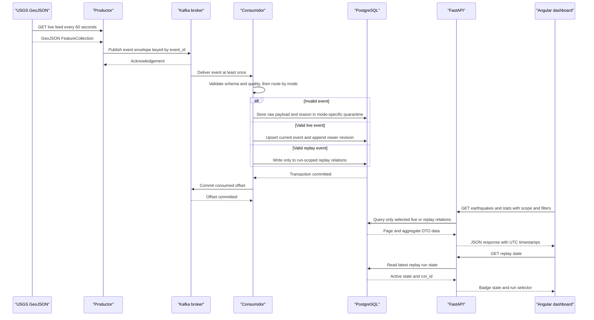

# t3 — Five-Service Architecture and API/Event Contracts

## Summary

This design fixes the local MVP boundary at five Compose services and specifies the private event pipeline, live/replay persistence boundary, HTTP contracts, and frontend-to-API DTOs. It uses only approved local integrations; no public tunnel, Netlify deployment, or additional Compose service is part of this design.

## Upstream Artifacts Consumed

- `.github/modernize/rearchitecture/artifacts/t2-pm.md` — MVP behavior traceability, canonical names, replay-isolation gap, and local-only scope.
- `.github/modernize/rearchitecture/artifacts/t3.1-teamlead.md` — resolved healthcheck and real-dependency startup policy.
- `.github/modernize/rearchitecture/artifacts/t1-teamlead.md` — user decisions for Angular, Natural Earth attribution/license, canonical services/topics/table names, UTC, and no publication.
- `specs/001-observatorio-sismico/spec.md` — FR-01–FR-09 and NFRs.
- `specs/001-observatorio-sismico/plan.md` — target service roles, event envelope, database/API direction, and replay workflow.
- `specs/001-observatorio-sismico/tasks.md` — service/API/consumer/frontend work boundaries and endpoint list.
- `specs/001-observatorio-sismico/data-spec.md` — USGS source semantics, quality rules, UTC units, and geographic assignment.
- `specs/001-observatorio-sismico/acceptance-tests.md` — TC-01–TC-11, particularly idempotency, quarantine, maritime events, recovery, and replay.
- `.specify/memory/constitution.md` — five-container, network, idempotency, replay, and data-integrity invariants.
- `.agents/AGENTS.md`, `.agents/rules/architecture_invariants.md`, `.agents/rules/data_quality_rules.md` — project-wide role, service, health, privacy, and quality requirements.
- `.agents/subagents/02-data-ingestion/AGENT.md`, `03-geospatial-quality/AGENT.md`, `04-backend-modeler/AGENT.md`, `05-frontend-cartographer/AGENT.md` — producer, processor, API/database, and UI integration responsibilities.
- `.agents/skills/usgs-ingestion/SKILL.md`, `kafka-idempotent-consumer/SKILL.md`, `spatial-strtree-pipeline/SKILL.md` — source request limits, database-before-offset behavior, and deterministic country matching.

## Evidence Mapping

- `t2-pm.md#Canonical Names and Explicit Resolutions` + `architecture_invariants.md#1-2` → canonical service IDs, private broker/database, local API binding, and fixed topic names below.
- `t3.1-teamlead.md#Decision` + `#Canonical Service Matrix` → healthchecks on all five services, only genuine `service_healthy` dependency edges, and no artificial edge on infrastructure roots.
- `t2-pm.md#Gaps and Handoff Notes` item 1 + `spec.md#FR-09` + `acceptance-tests.md#TC-11` → dedicated replay tables, scoped read contract, and run-state contract below.
- `spec.md#FR-01–FR-06` + `data-spec.md#1-3` + `kafka-idempotent-consumer/SKILL.md` → event envelope, topic routing, quality/quarantine behavior, and DB-before-offset sequence below.
- `spec.md#FR-07` + `04-backend-modeler/AGENT.md#3` → endpoint inventory, query parameters, and response DTO semantics below.
- `spec.md#FR-08` + `05-frontend-cartographer/AGENT.md#3` + user-approved t1 decision → Angular local client, shared filters, map/dashboard data, and `ND` rendering below.
- `t1-teamlead.md#Country boundaries and attribution` + `data-spec.md#1.3` → Natural Earth source, public-domain attribution, and honest `ADMIN` fallback below.
- `architecture_invariants.md#1` + `plan.md#4.1` → healthcheck design and an explicit resolution request for the root-service `depends_on` conflict below.

## Decisions and Naming

1. Use Compose DNS/service IDs exactly `productor`, `broker`, `consumidor`, `almacenamiento`, and `api`. Use a minimal Angular starter with the mandated Angular + Leaflet direction; do not invent a component library or design system. Run the frontend as a local dev server on the host, not a sixth Compose service. `productor`, `consumidor`, and `api` run only in their Compose containers.
2. Use Kafka topics `earthquakes.live` and `earthquakes.replay`. The live topic carries event envelopes and poll-audit control records; the replay topic carries replay-run controls and event envelopes. No topic named `earthquakes-replay` is used.
3. Keep the requested shared table names for live/current, baseline, quarantine, country, audit, and version data. Add isolated relations `replay_runs`, `replay_earthquakes`, `replay_versions`, and `replay_quarantine_events`; replay records never write to live/current or historical baseline relations.
4. Treat the historical 2025 catalog as an immutable comparison baseline, not as live/current events. Download/cache it in the producer's persistent named volume, then load it into `historical_2025` through a consumer bootstrap command. Reuse the cached files for replay. This avoids producer-to-database writes and keeps the number of services fixed.
5. Treat every source timestamp as UTC. Outer event-envelope `updated_ms` is the USGS integer Unix timestamp in milliseconds; normalized API/database timestamps use UTC ISO-8601 with `Z`. Preserve absent magnitude as `null` in JSON/SQL and render it as `ND`; negative magnitude/depth remain valid.
6. Require `run_id` when querying replay data. A run is isolated from other replay runs as well as from live data. The live API default is always live, including all analytics and historical comparison.
7. Natural Earth source: `https://raw.githubusercontent.com/nvkelso/natural-earth-vector/master/geojson/ne_110m_admin_0_countries.geojson`; public-domain terms: `https://www.naturalearthdata.com/about/terms-of-use/`. Include attribution: “Made with Natural Earth. Free vector and raster map data @ naturalearthdata.com.” Use `NAME_ES` only if present; otherwise expose `ADMIN` as the display-name fallback and do not claim the source supplies Spanish names.
8. The frontend and backend have no public deployment in this MVP. Allow local Angular origin `http://localhost:4200`; bind the API only to host loopback `127.0.0.1:8000`. Do not configure or use Netlify/ngrok.

## Service Catalog

| Service | Port | Category | Purpose |
|---|---|---|---|
| `productor` | none | Business / ingestion | Poll live USGS GeoJSON, stage/cache the 2025 catalog in a persistent named volume, and publish live/replay records to Kafka. |
| `broker` | `9092` internal only | Infrastructure | Single-node local Kafka/KRaft broker; private Compose DNS endpoint `broker:9092`. |
| `consumidor` | none | Business / processing | Consume both topics, validate/quarantine, enrich using the Natural Earth STRtree, and commit normalized records/audit state to PostgreSQL before committing Kafka offsets. It also imports the cached 2025 baseline. |
| `almacenamiento` | `5432` internal only | Infrastructure / persistence | PostgreSQL 16 stores live/current events, versions, immutable historical baseline, audit, country dimension, quarantine, and isolated replay relations. |
| `api` | `8000` container; host bind `127.0.0.1:8000` | API Layer | FastAPI read-only API for health, live/replay event views, analytics, and replay state. |

Compose exposes no host port for Kafka or PostgreSQL. All five containers use `restart: unless-stopped` and have healthchecks. Apply `depends_on: condition: service_healthy` only to actual prerequisite edges: `productor`→`broker`; `consumidor`→`broker` and `almacenamiento`; `api`→`almacenamiento`. `broker` and `almacenamiento` are independent roots and have no artificial `depends_on` edge. This follows the t3.1-teamlead resolution: every service is healthchecked, while startup gates represent only genuine runtime dependencies.

### Runtime health and readiness

| Service | Healthcheck contract |
|---|---|
| `almacenamiento` | `pg_isready` against its local database. |
| `broker` | Kafka CLI metadata/topic-list request against its local listener. |
| `productor` | Producer process alive and broker connection available. USGS availability is reported as source freshness, not container liveness. |
| `consumidor` | Consumer process alive and PostgreSQL/Kafka connections available. |
| `api` | Local `GET /api/v1/health`; readiness is 200 when PostgreSQL is reachable and 503 otherwise. |

Healthchecks avoid declaring a source outage as a dead container. API freshness fields still expose stale ingestion. Use `condition: service_healthy` on each listed dependency; health checks do not replace bounded retry/recovery after a dependency becomes unavailable at runtime.

## Event and Service Contracts

### Kafka topics and delivery

| Topic | Partitions / retention | Key | Records and route |
|---|---|---|---|
| `earthquakes.live` | 3 / 48 hours | Earthquake `event_id` UTF-8; poll control `poll_id` UTF-8 | Live USGS events and poll audit/failure control records. Event routing requires `mode=live`. |
| `earthquakes.replay` | 1 / 48 hours | Event `event_id` UTF-8; run controls `__run__:<run_id>` | One run's start control, ordered event envelopes, and finish control. Event routing requires `mode=replay` and a non-empty `run_id`. Single partition preserves run-control/event order for this local MVP. |

The producer waits for broker acknowledgements and may resend after uncertain delivery: delivery is at least once, not exactly once. Consumer auto-commit is disabled. It commits the offset for an individual message only after the corresponding PostgreSQL transaction commits. A database failure leaves the offset uncommitted for redelivery. A corrupt/invalid record is acknowledged only after the raw record and reason are durably written to the mode-specific quarantine relation. A non-earthquake type is excluded by the producer and included in the poll audit; it is not misrepresented as a valid earthquake.

### Versioned JSON envelope

Event record (`record_type=event`, schema version `1`):

```json
{
  "schema_version": 1,
  "record_type": "event",
  "source": "usgs_live",
  "ingested_at": "2026-11-02T16:00:00Z",
  "mode": "live",
  "event_id": "us7000example",
  "updated_ms": 1793635200000,
  "content_hash": "sha256:<hex>",
  "run_id": null,
  "payload": {"type": "Feature", "id": "us7000example"}
}
```

`payload` is the original USGS GeoJSON Feature; the example is illustrative, not a real event. `source` is `usgs_live`, `usgs_2025`, or `usgs_replay`; a replay must include the originating run ID. `ingested_at` is an RFC 3339 UTC instant. `content_hash` identifies the source payload bytes/canonical representation and is not an event ID.

Live poll-control record (`record_type=poll_audit`) carries `poll_id`, `source`, `requested_at`, `completed_at`, `http_status` (nullable on transport failure), `content_hash` (nullable on failure), counts received/accepted/excluded, and an error code/message without credentials. Consumer persists the record to `ingestion_audit`; failed fetch attempts are also structured in producer logs. An audit record has no event ID and must not enter the event tables.

Replay control records use `record_type=replay_started` and `record_type=replay_finished`, with `run_id` and UTC timestamps. Consumer persists run state to `replay_runs`. Replay events keep the event envelope, set `mode=replay`, and use the same `run_id`. A run's data and revisions are keyed by `(run_id, event_id)` so repeated replay does not overwrite live events or another run.

### Processing and persistence boundaries

1. Producer polls `all_day.geojson` every 60 seconds, accepts only `properties.type == earthquake`, and attaches source metadata. On 429/5xx/network errors, apply bounded exponential backoff and log/publish the failure audit; a source failure does not erase previously persisted state.
2. Historical download uses monthly half-open UTC intervals for all of 2025, `minmagnitude=4.0`, `eventtype=earthquake`, and `orderby=time-asc`; split any month over 18,000 records into half-month requests, deduplicate boundary IDs, cache month files, and expose an explicit bootstrap command. Bootstrap imports those files into `historical_2025` idempotently, through consumer quality/enrichment. The baseline is not inserted into `current_earthquakes`.
3. Consumer checks topic/mode agreement, envelope schema, event ID, finite/ranged longitude and latitude, finite depth, and valid UTC time/update values. Invalid input is stored with its original payload and explicit reason in `quarantine_events` for live or `replay_quarantine_events` for replay. Null magnitude remains valid; negative magnitude/depth are retained.
4. Consumer loads the Natural Earth WGS84 GeoJSON into Shapely geometries and a STRtree. It uses strict point/polygon intersection, no nearest-country or `place` inference; for boundary hits it chooses the lexicographically smallest `ADM0_A3`; no polygon hit maps to `N/A` / `Sin país asignado`. Use `NAME_ES` when supplied and otherwise `ADMIN`.
5. Each event write, version record, and associated audit/quarantine change occurs in one PostgreSQL transaction. Live upserts in `current_earthquakes` apply only when `EXCLUDED.updated_utc > current_earthquakes.updated_utc`; older/equal revisions have no effect. Replay writes only to replay relations. The consumer commits Kafka offsets after transaction success.
6. Historical comparisons read only `historical_2025` and live comparisons read only `current_earthquakes`; replay views read only a single `run_id` from replay relations. The replay stream never updates baseline/live aggregates.

The historical cache is a named Compose volume mounted read-write in `productor` and read-only in `consumidor`; it is not a sixth service or a committed dataset. API/consumer/database secrets are provided only through local environment variables. Broker and database have no host port mappings.

## API Endpoints Inventory

All paths are under `/api/v1`; JSON timestamps are UTC ISO-8601 ending in `Z`. API responses never include replay records unless the caller explicitly supplies `scope=replay` and a `run_id`.

| Service | Method | Path | Request type | Response type / status |
|---|---|---|---|---|
| `api` | GET | `/api/v1/health` | none | `HealthResponse`; 200 if API/DB ready, 503 if DB unavailable. |
| `api` | GET | `/api/v1/earthquakes` | Query: common filters below, plus `limit` (default 100, max 500), `offset` (default 0), `scope` (`live` default or `replay`), and required `run_id` for replay. | `EarthquakePage` with items, filtered total, pagination, scope/run ID. |
| `api` | GET | `/api/v1/stats/geo` | Query: common filters; scope/run rules apply. | `GeoStatsResponse`; one row per country/subregion, including `N/A` / `Sin país asignado`. |
| `api` | GET | `/api/v1/stats/hourly` | Query: common filters; scope/run rules apply. | `HourlyStatsResponse`; fixed one-hour UTC buckets by event occurrence time. |
| `api` | GET | `/api/v1/stats/distributions` | Query: common filters; scope/run rules apply. | `DistributionResponse`; magnitude bins of 0.5 and depth bins of 20 km, with null counts. |
| `api` | GET | `/api/v1/stats/historical-comparison` | Query: `adm0_a3`, `continent`, and `subregion` optional. Scope is fixed to live; no replay parameter. | `HistoricalComparisonResponse`; recent live 24h with magnitude ≥4 versus 2025 daily mean over 365 days. |
| `api` | GET | `/api/v1/replay/state` | none | `ReplayStateResponse`; most recent run, active flag, status and UTC timestamps; idle/null ID if none exists. |

**Common filters:** `start_utc`, `end_utc` (inclusive start, exclusive end), `mag_min`, `mag_max`, `depth_min_km`, `depth_max_km`, `adm0_a3`, `continent`, and `subregion`. List/geo/hourly/distribution defaults cover the preceding 24 hours when dates are omitted. An explicit replay scope requires `run_id`; a missing run returns an empty result for a valid ID rather than falling back to live. Query validation failures return 422 and invalid ranges (`start_utc >= end_utc`, min > max, or naive timestamps) are rejected. When a magnitude/depth bound is set, null values do not match that bounded predicate; without the bound, null-valued events remain visible.

`/stats/historical-comparison` uses the latest rolling 24-hour window and only events with `mag >= 4.0`; its comparison baseline is `historical_2025` total / 365, including days with no events. Its response ratio is `null` if the baseline mean is zero. It never includes replay.

## Management & Observability Endpoints

| Service | Endpoint | Custom metrics |
|---|---|---|
| `api` | `GET /api/v1/health` | `status`, database reachability, API UTC time, latest successful live poll/event ingestion times, and observed ingestion delay. |
| `api` | `GET /openapi.json`, `GET /docs` | FastAPI-generated contract and local interactive documentation; development/local use only. No Prometheus exporter or custom metrics endpoint is specified. |

Producer/consumer/broker/database health is container-healthcheck state, not extra HTTP endpoints. `HealthResponse` does not claim Kafka is healthy merely because API and PostgreSQL are available. No user authentication, authorization, or API TLS is configured; this is acceptable only for a local loopback MVP. Do not expose it through ngrok or another public ingress.

## DTOs & Contracts

| DTO / model | Role and mutability |
|---|---|
| `EarthquakeDTO` | Immutable API response for one normalized event; magnitude/depth may be null; includes event ID, occurrence/update/ingestion UTC times, coordinates, country fields, and source scope. |
| `EarthquakePage` | Immutable paginated response envelope with `items`, `total`, `limit`, `offset`, `scope`, and optional `run_id`. |
| `HealthResponse` | Immutable API health/freshness response. |
| `GeoStatsResponse` / `GeoStatDTO` | Immutable geographic group and magnitude aggregate response; `magnitude_count` distinguishes null magnitude from zero. |
| `HourlyStatsResponse` / `HourlyStatDTO` | Immutable hourly UTC aggregation response. |
| `DistributionResponse` / `HistogramBinDTO` | Immutable histogram-bin response with explicit null counts. |
| `HistoricalComparisonResponse` | Immutable fixed-live-window / 2025-baseline comparison response. |
| `ReplayStateResponse` | Immutable state for the newest replay run; the returned run ID is used to request the isolated replay view. |
| `EventEnvelopeV1` | Versioned Kafka event/control contract described above; producer-owned, consumer-validated. |

DTOs are Pydantic response models and are serialized as JSON by FastAPI. No gateway-level aggregation service exists: the Angular SPA calls the API directly. OpenAPI is generated from the FastAPI models and endpoint declarations; no separate GraphQL/protobuf contract is used. Responses include no database credentials or raw configuration.

## Communication Patterns

- **External synchronous pull:** `productor` polls the USGS live feed every 60 seconds and calls the FDSN event API for cached 2025 monthly intervals. Apply bounded exponential backoff for 429/5xx/network failures; honor `Retry-After` when supplied. No circuit-breaker library is required for this bounded local MVP.
- **Internal asynchronous publish/consume:** producer→Kafka→consumer, at-least-once, keyed by event ID for events. Replay controls and replay events share their dedicated single-partition topic. Consumer has manual commits and database-before-offset ordering.
- **Persistence/read path:** consumer writes through async PostgreSQL transactions; API reads via an async connection pool. Producer does not write database tables directly. The historical bootstrap is a consumer-owned command reading the staged volume.
- **Frontend:** Angular development server at `http://localhost:4200` uses HTTP JSON calls to the loopback API. Poll health/data at the selected dashboard refresh cadence and poll replay state more frequently while active so a short replay run is not missed. On API loss keep the last valid response and show disconnected status.
- **Service discovery:** Docker Compose service DNS only (`broker:9092`, `almacenamiento:5432`, `api:8000`). No service registry, gateway, load balancer, retrying API gateway, or cross-service HTTP call is present.
- **Startup dependencies:** broker and PostgreSQL are independent roots. Producer waits for broker health; consumer waits for broker and PostgreSQL health; API waits for PostgreSQL health. Restart policy is `unless-stopped`. Healthchecks cover all five services, subject to the all-services dependency conflict noted above.
- **Security posture:** all backend services communicate on the private Compose network; only API is bound to host loopback. CORS allows the local Angular origin and only required headers. No authentication or app-level TLS; no public tunnel/deployment in scope. `.env` secrets remain untracked and `.env.example` contains placeholders.
- **Performance target:** preserve the specification's `<250 ms` aggregate-response target for the local data set, to be measured during implementation/runtime validation; this design is not evidence that the target has been met.

## Service Technology Matrix

| Service | Web | Data access | Discovery | Gateway | Health | Cache | Metrics |
|---|---|---|---|---|---|---|---|
| `productor` | none | USGS HTTP client; staged files | Compose DNS | none | process + broker check | persistent monthly USGS file cache | structured logs / poll audit |
| `broker` | none | Kafka log | Compose DNS | none | Kafka CLI check | Kafka topic retention | none specified |
| `consumidor` | none | `asyncpg` / PostgreSQL; Shapely STRtree | Compose DNS | none | process + DB/Kafka check | in-memory country geometries/STRtree | structured logs |
| `almacenamiento` | none | PostgreSQL 16 | Compose DNS | none | `pg_isready` | none specified | none specified |
| `api` | FastAPI / Uvicorn | `asyncpg` pool | Compose DNS | none | `/api/v1/health` | no response cache specified | health/freshness fields |

## Service Communication Sequence

<!-- mermaid-checked: every participant uses `participant Id as "Label"`, no \n in aliases/messages/notes, every alt/opt/loop closed by end, no `:` inside any alias -->


## Risks and Handoff

- **INFO — dependency policy:** implementation must follow t3.1-teamlead's resolution: all five services have healthchecks; only the four genuine dependency edges are declared, leaving `broker` and `almacenamiento` as roots.
- **MEDIUM — replay state ordering:** maintain the replay topic's single partition and emit start/events/finish in that order. If partitioning is changed, replace this ordering guarantee with a durable completion protocol before implementation.
- **MEDIUM — bootstrap sequencing:** document the historical download and consumer import commands, retain a completion manifest in the shared cache, and expose baseline readiness in API health/compare output. Do not report a comparison as valid while the baseline is absent/incomplete.
- **MEDIUM — source naming:** Natural Earth does not guarantee `NAME_ES`; implement the documented `ADMIN` fallback and retain raw source properties/attribution.
- **LOW — public security assumptions:** there is no authentication/TLS in the local MVP. Any later public hosting request requires a separate security/deployment design and is outside this task.

## Verification

- Manually checked the service count and canonical names against t1/t2 and the project invariant.
- Applied the resolved health/dependency policy from t3.1-teamlead; no artificial dependency is specified for the broker or database roots.
- Checked the API route list against FR-07, the backend role contract, and PM traceability; added explicit replay-state and scope behavior to close the PM handoff gap.
- Checked the envelope, source units, validation, replay routing, and manual offset protocol against the ingestion/geospatial skills and TC-01–TC-08/TC-11.
- Checked Mermaid syntax against the loaded skill constraints: all participants use quoted aliases, there are no line breaks in aliases/messages, the `alt` block is closed, and no alias contains a colon.
- Validation command: PowerShell inline Python contract assertions against this artifact.
- Passed: 8/8 checks — exact five service IDs, private broker/database and loopback API, resolved health policy, canonical topics, required API routes, replay isolation, DB-before-offset order, and Mermaid syntax.
- No application source/build/runtime tests were run: architect ownership is design-only and no implementation was changed.
