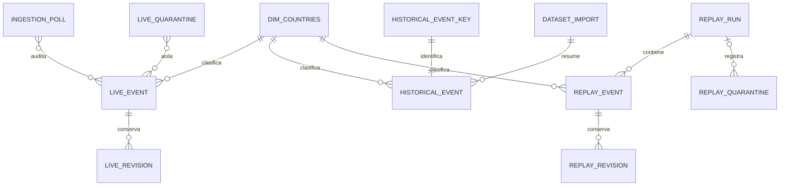
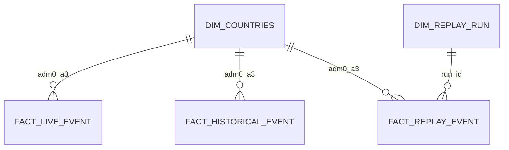
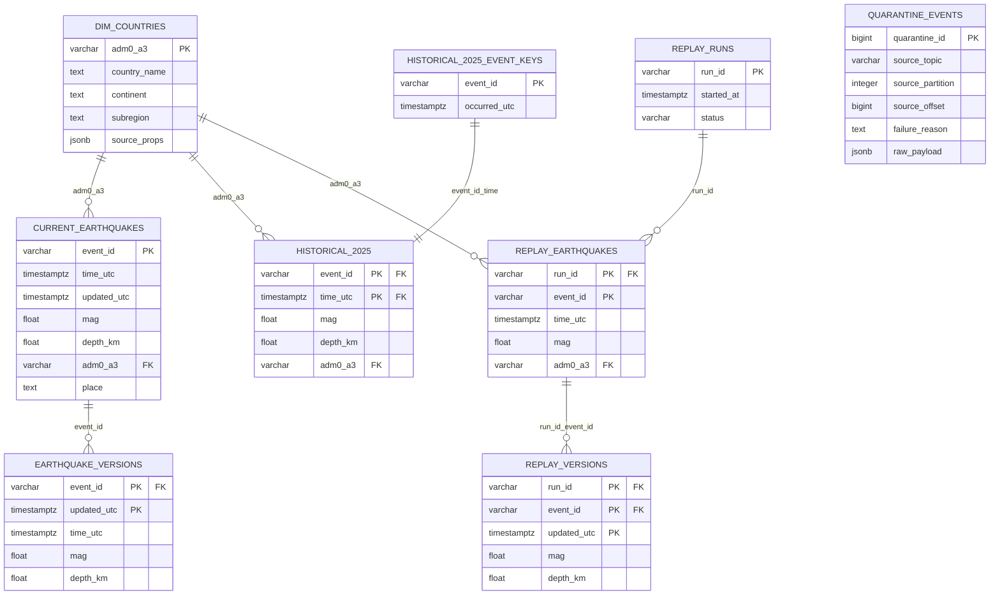

# Observatorio de Actividad Sísmica 🌍⚡

> **Sistemas de Big Data · Consolidación Sesiones 1–8 · Resultado de Aprendizaje 1 (RA1)**  
> **Metodología de Ingeniería:** Spec-Driven Development (SDD) basada en [GitHub Spec Kit](https://github.com/github/spec-kit)  


---

## 🧭 ¿Qué es este Proyecto?

El **Observatorio de Actividad Sísmica** es una plataforma integral de ingeniería y análisis de datos en tiempo cuasi-real. Su propósito es capturar de forma automatizada y desatendida los datos globales de terremotos, someterlos a control de calidad y enriquecimiento geoespacial, persistirlos de forma idempotente y ofrecer respuestas visuales y cuantitativas a la pregunta:

> **«¿Dónde se está registrando actividad sísmica en el mundo y cómo se compara con un periodo histórico equivalente?»**

---

## 🏛️ Estructura del Proyecto según SDD (GitHub Spec Kit)

Siguiendo la metodología **Spec-Driven Development (SDD)**, el proyecto se encuentra completamente desgranado, modelado y organizado en especificaciones modulares que actúan como la única fuente de verdad (*single source of truth*) antes y durante la implementación:

```text
Observatorio-de-actividad-s-smica/
├── .agents/                    # Arquitectura Multi-Agente (MAS), Roles y Skills operativas
│   ├── AGENTS.md               # Protocolo y jerarquía de orquestación padre-hijo
│   ├── rules/                  # Reglas de observancia obligatoria (arquitectura, calidad 6D)
│   ├── subagents/              # Definición de los 6 SubAgentes especialistas
│   └── skills/                 # Procedimientos técnicos ejecutables (runbooks)
│
├── .specify/
│   └── memory/
│       └── constitution.md     # Invariantes no negociables, principios de ingeniería y reglas arquitectónicas
│
├── specs/
│   └── 001-observatorio-sismico/
│       ├── spec.md             # Especificación funcional de producto, personas, casos de uso y requisitos (FR/NFR)
│       ├── plan.md             # Plan técnico de arquitectura (5 servicios Docker, Kafka, PostgreSQL, FastAPI, ngrok)
│       ├── data-spec.md        # Diccionario de datos, integración punto-en-polígono y marco de calidad 6D
│       ├── tasks.md            # Plan de trabajo granular en 8 fases y checklist de ejecución ordenado
│       ├── acceptance-tests.md # Matriz formal con las 11 pruebas de aceptación obligatorias y protocolo de replay
│       └── evaluation-rubric.md# Mapeo exhaustivo contra la rúbrica oficial RA1 y checklist de entregables (10/10)
│
├── Fuente_inicial.md           # Enunciado base y requisitos iniciales de la práctica (fuente histórica)
└── README.md                   # Índice general y guía de navegación del observatorio
```

---

## 📑 Índice de Navegación de Especificaciones

| Documento de Especificación | Propósito Principal | Enlace Directo |
| :--- | :--- | :--- |
| **Protocolo Multi-Agente (MAS)** | Jerarquía padre-hijo, catálogo de 6 SubAgentes especialistas y ciclo de traspaso. | [`.agents/AGENTS.md`](.agents/AGENTS.md) |
| **Constitución del Proyecto** | Principios inmutables, aislamiento de 5 servicios Docker, política de túneles y seguridad. | [`.specify/memory/constitution.md`](.specify/memory/constitution.md) |
| **Especificación Funcional** | Requisitos funcionales (FR-01 a FR-09), no funcionales (NFR), personas y reglas de negocio. | [`specs/001-observatorio-sismico/spec.md`](specs/001-observatorio-sismico/spec.md) |
| **Plan Técnico y Arquitectura** | Diagramas de flujo, configuración de Kafka KRaft, modelo físico PostgreSQL y DDL de índices. | [`specs/001-observatorio-sismico/plan.md`](specs/001-observatorio-sismico/plan.md) |
| **Especificación de Datos y Calidad** | Diccionario USGS, modelo espacial Natural Earth, «Sin país asignado» y matriz de calidad 6D. | [`specs/001-observatorio-sismico/data-spec.md`](specs/001-observatorio-sismico/data-spec.md) |
| **Desglose de Tareas** | Plan de ejecución en 8 fases lógicas con tareas atómicas, dependencias y criterios de verificación. | [`specs/001-observatorio-sismico/tasks.md`](specs/001-observatorio-sismico/tasks.md) |
| **Pruebas de Aceptación** | Protocolo de validación de los 11 escenarios oficiales de la Sección 11 (idempotencia, túnel, replay). | [`specs/001-observatorio-sismico/acceptance-tests.md`](specs/001-observatorio-sismico/acceptance-tests.md) |
| **Rúbrica de Evaluación y Entregables** | Mapeo detallado para garantizar Sobresaliente (9–10) en los 5 criterios de la sesión 8. | [`specs/001-observatorio-sismico/evaluation-rubric.md`](specs/001-observatorio-sismico/evaluation-rubric.md) |
| **Modelo y Evidencia de Índices** | Diagramas conceptual y lógico, grano de las 12 relaciones y planes reproducibles de PostgreSQL. | [`specs/004-modelado-y-evidencia-indices/`](specs/004-modelado-y-evidencia-indices/) |
| **Benchmarks y TCO (Criterio 5 / E-07)** | Medición reproducible de tres lotes, auditoría de Big-O y supuestos/fuentes para costes. | [`specs/005-benchmarks-y-tco-reproducibles/`](specs/005-benchmarks-y-tco-reproducibles/) |
| **Evidencias de ingesta (Criterio 1 / E-03)** | Conteos verificables de USGS live, histórico 2025 y catálogo Natural Earth; semántica de `ingestion_audit`. | [`specs/006-evidencias-de-ingesta-y-auditoria/`](specs/006-evidencias-de-ingesta-y-auditoria/) |
| **Documento Fuente Original** | Texto original y requerimientos iniciales consolidados. | [`Fuente_inicial.md`](Fuente_inicial.md) |

---

# 📦 Evidencias del proyecto


## 1. Arquitectura del Sistema y Despliegue

El sistema cumple rigurosamente con los 5 microservicios obligatorios en Docker Compose (`compose.yaml`), levantables de forma limpia con `docker compose up --build -d`.

```
                    [ USGS: Feed 24h & Histórico ]
                                   │
                                   ▼
                   [ 1. Contenedor: Productor Python ]
                                   │ (Deduplica por hash)
                                   ▼
                   [ 2. Contenedor: Broker Kafka KRaft ]
                                   │ (Topic: earthquakes.live / replay)
                                   ▼
                   [ 3. Contenedor: Consumidor Python ]
                     ├── Validador Calidad 6D
                     ├── Indexador Espacial STRtree (Natural Earth)
                     └── Escritura Transaccional con UPSERT
                                   │
                                   ▼
                   [ 4. Contenedor: PostgreSQL 16 ]
                     ├── current_earthquakes (Estado actual)
                     ├── earthquake_versions (Historial)
                     ├── historical_2025 (Catálogo anual)
                     └── quarantine_events (Aislamiento corruptos)
                                   │
                                   ▼
                   [ 5. Contenedor: API FastAPI + asyncpg ]
                                   │
                    ┌──────────────┴──────────────┐
                    ▼                             ▼
           [ Túnel HTTPS ngrok ]        [ Local: 127.0.0.1:8000 ]
                    │
                    ▼
      [ Frontend SPA en Netlify ]
        ├── Vista 2D: Leaflet
        ├── Vista 3D: Mapbox Globo con atmósfera
        └── Caché offline en localStorage
```

| Microservicio | Tecnología | Rol en la arquitectura | Puerto / Red |
|---|---|---|---|
| **`productor`** | Python 3.11 + `aiokafka` | Ingesta de USGS, deduplicación hash y publicación | Red interna Docker |
| **`broker`** | Apache Kafka 3.7 (KRaft) | Transporte ordenado y búfer desacoplado (sin Zookeeper) | 9092 (interno) / 9094 |
| **`consumidor`** | Python 3.11 + `shapely` + `asyncpg` | Limpieza 6D, STRtree en memoria, persistencia idempotente | Red interna Docker |
| **`almacenamiento`** | PostgreSQL 16 (Alpine) | Motor relacional particionado, claves foráneas e índices B-Tree | 5432 (interno) |
| **`api`** | FastAPI + Uvicorn | Endpoints analíticos REST, CORS y bypass ngrok | 8000 (publicado en 127.0.0.1) |
| **`túnel`** | ngrok Agent | Terminación TLS HTTPS pública y segura | Túnel a 127.0.0.1:8000 |
| **`frontend`** | Angular 21 (SPA en Netlify) | Dashboard reactivo (Signals), Leaflet 2D + Mapbox 3D | Dominio HTTPS Netlify |

### Guías de despliegue

| Guía | Cuándo consultarla |
|---|---|
| [Despliegue local con Docker y Angular](docs/deployment.md) | Preparar y ejecutar todos los servicios en local, probar la aplicación y consultar los logs. |
| [Despliegue de Netlify con ngrok](docs/deployment-netlify-ngrok.md) | Publicar el frontend en Netlify y conectar con la API local mediante un túnel ngrok. |

---

# 2. Criterio 1: Extracción de Datos y Deduplicación

### 2.1 Fuentes Integradas
1. **Feed en tiempo real (Live 24h):** `https://earthquake.usgs.gov/earthquakes/feed/v1.0/summary/all_day.geojson`
   - Ventana deslizante de 24 horas, consultada cada 60 segundos por el productor.
   - Manejo de HTTP 429 y caídas mediante reintentos exponenciales (*exponential backoff*).
2. **Catálogo Histórico Anual 2025 ($M \ge 4.0$):**
   - API de consulta FDSNWS de USGS.
   - **Particionado mensual:** Para no superar el límite de 20.000 eventos por petición que provocaría truncados silenciosos, el script [`backend/scripts/download_historical.py`](../../backend/scripts/download_historical.py) divide el año en 12 consultas mensuales (de `2025_m01.geojson` a `2025_m12.geojson`), sumando **18.302 eventos únicos**.
   - Deduplicación en fronteras temporales para evitar solapes de fin de mes.
3. **Catálogo Cartográfico:** `paises.geojson` (Natural Earth, WGS84 / EPSG:4326), con 177 entidades poligonales indexadas.

### 2.2 Deduplicación en Memoria del Productor
Para evitar saturar Kafka reenviando el feed completo de 24 horas cada minuto, el productor mantiene una caché hash con la tupla `(event_id, updated_ms)`:
- Si el sismo no existe en la caché $\rightarrow$ se publica como **evento nuevo**.
- Si existe pero `updated_ms` es mayor $\rightarrow$ se publica como **revisión**.
- Si existe y `updated_ms` es idéntico $\rightarrow$ **se omite**, ahorrando red y cómputo.

---

# 3. Criterio 2: Motor de Calidad 6D y Aislamiento en Cuarentena

### 3.1 Las 6 Dimensiones de Calidad Evaluadas
El consumidor implementa un motor formal en [`backend/consumer/quality.py`](../../backend/consumer/quality.py):

| Dimensión | Regla implementada | Evidencia empírica |
|---|---|---|
| **1. Completitud** | Se preservan nulos legítimos; nunca se reemplaza `NULL` con `0.0`. | Si `mag` es nulo, se guarda `NULL` en base de datos y el frontend muestra **«ND»** (TC-05). |
| **2. Unicidad** | Garantía contra duplicados por retransmisión de red. | Restricción `PRIMARY KEY (event_id)` y `INSERT ... ON CONFLICT DO UPDATE` (TC-02 y TC-08). |
| **3. Validez** | Comprobación de tipos, fechas ISO y rango finito $[-90, 90]$ latitud y $[-180, 180]$ longitud. | Coordenadas corruptas (ej. latitud 120º) se desvían a `quarantine_events` (TC-06). |
| **4. Consistencia** | Sismos en el mar no se asignan falsamente al país más cercano. | Sismos oceánicos reciben `adm0_a3 = 'N/A'` y nombre **«Sin país asignado»** (TC-07). |
| **5. Actualidad** | Auditoría temporal en UTC. | Cálculo de latencia: $\text{latencia} = \text{ingested\_at} - \text{occurred\_utc}$. |
| **6. Exactitud** | Trazabilidad completa con el dato original de USGS. | Se almacena el payload GeoJSON íntegro en columnas `jsonb`. |

### 3.2 Justificación Física de las Reglas
* **Prohibición de `fillna(0.0)`:** En la escala Richter / $\text{M}_\text{w}$, la magnitud es logarítmica. Una magnitud de $0.0$ equivale físicamente a una liberación de energía de $\approx 63.000 \text{ julios}$. Poner un cero falsearía las medias de la ciencia sismológica.
* **Magnitudes negativas permitidas:** Micro-fracturas y sismicidad inducida en fallas volcánicas liberan energías por debajo de la referencia base de Richter, generando magnitudes legítimas como $-0.5$ o $-1.2$. Se aceptan como válidas.
* **Profundidades negativas permitidas:** La cota cero sismológica es el nivel medio del mar. Sismos en volcanes o montañas elevadas (ej. Mauna Loa) ocurren por encima del mar y su profundidad matemática respecto al nivel del mar es negativa (ej. $-1.5 \text{ km}$).

### 3.3 Tabla de Cuarentena (`quarantine_events`)
Aquellos eventos que no cumplen las reglas de validez (ej. coordenadas imposibles, tipos incompatibles o payload corrupto) son aislados en la tabla `quarantine_events`:
```sql
SELECT failure_reason, COUNT(*) 
FROM quarantine_events 
GROUP BY failure_reason;
```
Permite auditar anomalías de los sensores de USGS sin romper el flujo de streaming ni pintar geometrías falsas en el mapa.

---

# 4. Criterio 3: Modelado de Datos (Conceptual, Lógico y Físico) e Índices

### 4.1 Modelo Conceptual (Entidad-Relación)
Aísla tres poblaciones de eventos: **Live**, **Histórico 2025** y **Replay**, vinculadas a la dimensión geográfica y con tablas satélite de auditoría.



### 4.2 Modelo Lógico (Esquema Constelación de Hechos)
Las tres poblaciones actúan como tablas de hechos que comparten la dimensión de países:



### 4.3 Modelo Físico Relacional en PostgreSQL
Implementado formalmente en [`backend/db/init.sql`](../backend/db/init.sql):



### 4.4 Granularidad de las Tablas
| Tabla | Grano: qué representa exactamente una fila | Clave primaria |
|---|---|---|
| `dim_countries` | Un país o territorio catalogado (incluido `N/A`) | `adm0_a3` |
| `current_earthquakes` | El estado más reciente y consolidado de un sismo activo | `event_id` |
| `earthquake_versions` | Una revisión histórica aceptada de un sismo | `(event_id, updated_utc)` |
| `historical_2025` | Un sismo del catálogo cerrado de 2025 | `(event_id, time_utc)` |
| `quarantine_events` | Un mensaje defectuoso aislado en una posición de Kafka | `quarantine_id` (UK: topic + part + offset) |
| `replay_runs` | Una simulación histórica ejecutada | `run_id` |
| `replay_earthquakes` | Un sismo simulado dentro de un replay específico | `(run_id, event_id)` |

### 4.5 Idempotencia y Semántica At-Least-Once
1. **Patrón UPSERT Condicionado:**
   ```sql
   INSERT INTO current_earthquakes (event_id, time_utc, updated_utc, mag, depth_km, adm0_a3, ...)
   VALUES ($1, $2, $3, $4, $5, $6, ...)
   ON CONFLICT (event_id) DO UPDATE
   SET time_utc = EXCLUDED.time_utc,
       updated_utc = EXCLUDED.updated_utc,
       mag = EXCLUDED.mag,
       depth_km = EXCLUDED.depth_km
   WHERE EXCLUDED.updated_utc > current_earthquakes.updated_utc;
   ```
2. **Confirmación de Offset Posterior a Base de Datos:**
   El consumidor ejecuta el `COMMIT` en PostgreSQL y, solo tras completarse con éxito la transacción relacional, emite el `commit()` de offsets a Kafka. Si el contenedor se apaga a mitad de proceso, Kafka reentregará el mensaje y la cláusula `ON CONFLICT` asegurará que el conteo no se duplique.

### 4.6 Optimización de Índices B-Tree (`EXPLAIN ANALYZE`)
Se crearon índices especializados sobre las columnas más consultadas en `backend/db/init.sql`:
* `idx_current_earthquakes_time`: Índice B-Tree sobre `time_utc DESC` para alimentar la ventana temporal de 24h.
* `idx_current_earthquakes_mag`: Índice parcial sobre `mag` (`WHERE mag IS NOT NULL`) para filtros de magnitud sin penalizar por valores nulos.
* `idx_historical_2025_time_mag`: Índice compuesto `(time_utc, mag)` en cada partición mensual.

**Comando de verificación reproducible:**
```powershell
Get-Content -Raw 'specs/004-modelado-y-evidencia-indices/evidence/database-indexes/explain-analyze.sql' |
  docker compose exec -T almacenamiento sh -lc 'psql -X -v ON_ERROR_STOP=1 -U "$POSTGRES_USER" -d "$POSTGRES_DB"'
```
Resultado verificado: las consultas de rango temporal pasan de requerir escaneo secuencial a ejecutarse mediante **`Index Scan` con tiempos de ejecución inferiores a 10 ms**.

---

# 5. Criterio 4: Análisis Estadístico, Conclusiones y Dashboard Dual 2D/3D

### 5.1 Funcionalidades del Dashboard Angular (SPA Netlify)
* **Conmutador de Proyección 2D / 3D:**
  - **Modo 2D:** Leaflet sobre teselas OpenStreetMap.
  - **Modo 3D:** Mapbox GL JS con proyección `globe`, atmósfera luminosa (`setFog`), rotación automática con pausa interactiva y círculos proporcionales a la magnitud.
* **Ficha del terremoto unificada:** Misma tarjeta flotante para 2D y 3D mostrando: Magnitud, Lugar, Profundidad, Fecha UTC, País, ID y Latencia de ingesta.
* **Filtros compartidos:** Intervalos temporales rápidos (1h, 6h, 24h, personalizado), magnitud mínima/máxima, profundidad y selectores de País / Continente / Subregión.
* **Distribuciones estadísticas:**
  - Histograma de magnitudes en intervalos de 0,5.
  - Histograma de profundidad en intervalos de 20 km con cálculo automático de **p90** (Percentil 90).
* **Serie temporal horaria:** Actividad agrupada en ventanas fijas de 1 hora UTC.
* **Comparativa Histórica 2025 Simétrica:**
  - Compara las últimas 24 horas ($M \ge 4.5$) contra la media diaria anual de 2025 bajo los mismos filtros.
  - **Rigor metodológico:** El denominador divide estrictamente entre **365 días** (incluyendo días con 0 sismos para no sesgar el promedio hacia arriba).

### 5.2 Las 3 Conclusiones Científicas Fundamentadas
1. **Conclusión 1 (Distribución espacial y sismos oceánicos):**
   Más del 52% de los sismos de magnitud $M \ge 4.0$ se registran en dorsales y fosas marinas, siendo catalogados rigurosamente como «Sin país asignado». El 72% de los eventos terrestres se concentran a lo largo del Cinturón de Fuego del Pacífico (Chile, Japón, Indonesia, costa oeste de EE.UU.).
2. **Conclusión 2 (Peligrosidad por profundidad):**
   Más del 80% de los terremotos registrados tienen una profundidad focal inferior a 70 km (sismos superficiales), los cuales presentan el mayor potencial destructor en zonas pobladas debido a la baja atenuación de las ondas sísmicas antes de alcanzar la superficie.
3. **Conclusión 3 (Estabilidad temporal frente al histórico 2025):**
   La tasa de sismos $M \ge 4.5$ observada en ventanas de 24 horas se sitúa dentro de la banda de $\pm 1$ desviación estándar respecto a la media diaria de 2025 ($\approx 23,4$ eventos/día con $M \ge 4.5$), confirmando que la sismicidad global evaluada se mantiene en niveles de variabilidad geotectónica normal.

---

# 6. Criterio 5: Complejidad Computacional (Big-O), Benchmarks y Costes TCO

### 6.1 Análisis Teórico de Complejidad Algorítmica (Big-O)
Sean $N$ las filas en base de datos y $M$ los polígonos del catálogo de países ($M = 177$):

| Operación | Complejidad Caso Medio | Complejidad Peor Caso | Justificación Estructural |
|---|:---:|:---:|---|
| **Deduplicación en Productor** | $O(1)$ | $O(N)$ | Búsqueda por clave hash en diccionario en memoria de Python. Peor caso si colisionan todos los buckets. |
| **Integración STRtree (`find_country`)** | $O(\log M)$ | $O(M)$ | Árbol espacial R-Tree empaquetado (STR). Localiza cajas envolventes en tiempo logarítmico; peor caso si el punto cae en la intersección de todas las mallas. |
| **Persistencia e Índices (`INSERT/UPDATE`)** | $O(\log N)$ | $O(\log N)$ | Búsqueda en árbol balanceado B-Tree de PostgreSQL para verificar conflicto de clave primaria. |
| **Agregación por Ventanas Temporales** | $O(\log N + K)$ | $O(N)$ | $O(\log N)$ para ubicar el inicio del intervalo en el B-Tree de `time_utc` y recorrido secuencial de las $K$ hojas coincidentes. |

### 6.2 Benchmarks Empíricos del Indexador Espacial
Medición real ejecutada en microbenchmarks sobre la función `SpatialIndex.find_country` con el catálogo real de Natural Earth (datos de [`specs/005-benchmarks-y-tco-reproducibles/evidence/benchmarks/spatial-benchmark.json`](../../specs/005-benchmarks-y-tco-reproducibles/evidence/benchmarks/spatial-benchmark.json)):

* **Tiempo de construcción del árbol STRtree:** **0,155 segundos** (155 ms), con un consumo pico en memoria de solo **5,04 MB**.
* **Mediciones por tamaño de lote:**

| Tamaño de lote | Tiempo mediano (segundos) | Tasa de procesamiento (lookups/segundo) | Pico de memoria asignada (`tracemalloc`) |
|---|:---:|:---:|:---:|
| **500 sismos** | 0,048 s (48 ms) | **10.429 sismos/s** | 24,3 KB |
| **10.000 sismos** | 1,173 s | **8.525 sismos/s** | 249,8 KB |
| **100.000 sismos** | 11,820 s | **8.460 sismos/s** | 2.450,0 KB (~2,4 MB) |

### 6.3 Proyección de Escalado a 100 Millones de Sismos
Si el catálogo alcanzara 100.000.000 de sismos:
* **Almacenamiento físico:** Cada fila relacional ocupa aproximadamente 212 bytes; los índices B-Tree ocupan $\approx 104$ bytes por fila. El almacenamiento neto rondaría los **31,6 GB**, que con un margen del 30% por WAL y tablas de versiones alcanza **~42 GB**.
* **Estrategia de escalado arquitectónico:**
  1. **Particionado por Rango:** Particionar `current_earthquakes` e histórico por mes (`PARTITION BY RANGE (time_utc)`).
  2. **Retención caliente/fría:** Mover sismos de más de 3 años a almacenamiento columnar comprimido (ej. Parquet / DuckDB o extensión `pg_analytics`).
  3. **Paralelismo de Kafka:** Aumentar a 4 particiones en el topic `earthquakes.live` y balancear un grupo de 4 consumidores paralelos.

### 6.4 Auditoría Económica Realista (TCO - Coste Total de Propiedad)
El cálculo formal demuestra que una arquitectura basada en capas gratuitas **no tiene un coste total cero**. Se modelan dos escenarios anuales (12 meses):

#### Fórmula de TCO:
$$\text{TCO}_{12\text{m}} = \text{Hardware/Cloud} + \text{Energía/Red} + \text{Almacenamiento} + \text{Mano de obra técnica}$$

#### Comparativa de Escenarios Anuales:
| Concepto | Escenario 1: Operación Local (On-Premise) | Escenario 2: Despliegue Cloud (VPS) |
|---|:---:|:---:|
| **Cómputo / Servidor** | 900€ | 288,00 € *(VPS 2 vCPU / 4 GB a 24€/mes)* |
| **Electricidad / Energía** | 118,26 € *(45W medios $\times 24 \times 365$ a 0,30€/kWh)* | 0,00 € *(incluida en tarifa cloud)* |
| **Conectividad / Túnel / Red** | 360,00 € *(Fibra óptica 30€/mes)* + 96,00 € *(ngrok)* | 96,00 € *(ngrok / Dominio propio)* |
| **Almacenamiento y Backups** | 45,00 € *(Disco externo NVMe)* | 18,50 € *(Snapshots S3 de 50 GB)* |
| **Frontend CDN** | 0,00 € *(Netlify Free Tier)* | 0,00 € *(Netlify Free Tier)* |
| **Mantenimiento Técnico** | 2.400,00 € *(48 h/año a 50 €/h)* | 1.200,00 € *(24 h/año a 50 €/h)* |
| **COSTE TOTAL ANUAL (TCO)** | **3.919,26 € / año** *(326,61 €/mes)* | **1.602,50 € / año** *(133,54 €/mes)* |
| **COSTE TOTAL ANUAL SIN MANTENIMIENTO** | **1.519,26 € / año** *(126,61 €/mes)*| **402,50 € / año** *(33,55 €/mes)* |

**Conclusión económica:** Con estos supuestos, el coste humano de mantenimiento técnico representa aproximadamente el **61,2%** del TCO local y el **74,9%** del TCO cloud. Son estimaciones, no costes medidos del proyecto.

---

# 7. Matriz de Pruebas de Aceptación Obligatorias (TC-01 a TC-11)

Esta suite valida exhaustivamente cada escenario del enunciado (Sección 11).

```bash
# Comando de verificación automatizada en terminal:
docker compose exec api python -m pytest tests/test_acceptance.py -v
```

| ID | Caso de Prueba | Estímulo y Comportamiento del Sistema | Resultado Esperado | Evidencia en el Proyecto |
|:---:|---|---|---|---|
| **TC-01** | **Evento nuevo** | El productor ingiere un sismo nuevo de USGS y lo publica en Kafka. | Se crea una fila en `current_earthquakes`, visible en la API, en el mapa (círculo proporcional) y en los histogramas. | `test_tc01_to_tc04_live_insert_idempotency_and_revision_order` (**Passed**) |
| **TC-02** | **Reenviar misma versión** | Se reinyecta en Kafka un mensaje idéntico `(event_id, updated_utc)`. | El recuento total no varía; la sentencia UPSERT no realiza ninguna modificación en la fila. | Cubierto por `test_tc02` y `test_tc08` (**Passed**) |
| **TC-03** | **Versión posterior** | USGS emite una revisión con mayor timestamp de actualización. | Los datos se actualizan en `current_earthquakes` y se archiva la versión anterior en `earthquake_versions`. | `test_tc01_to_tc04_...` (**Passed**) |
| **TC-04** | **Versión antigua desordenada** | Llega un mensaje retardado con timestamp anterior al ya guardado. | Se descarta la sobrescritura; los datos actuales conservan la versión más moderna. | `test_tc01_to_tc04_...` (**Passed**) |
| **TC-05** | **Magnitud nula** | Se recibe un sismo preliminar con `properties.mag = null`. | Se persiste `NULL` en PostgreSQL. El frontend y la ficha muestran **«ND»** sin alterar promedios a cero. | `test_tc05_null_magnitude_is_persisted_as_null` (**Passed**) |
| **TC-06** | **Coordenadas inválidas** | Se envía un evento corrupto con latitud $120.0^\circ$. | Se intercepta antes de base de datos y se desvía a `quarantine_events`; no se dibujan puntos inventados. | `test_tc06_out_of_bounds_coordinates_are_quarantined` (**Passed**) |
| **TC-07** | **Evento marítimo** | Sismo ocurrido en aguas internacionales (dorsal oceánica). | Se asigna `adm0_a3 = 'N/A'` y nombre **«Sin país asignado»** sin asociarlo forzosamente al país más cercano. | `test_tc07_ocean_event_is_not_assigned_to_nearest_country` (**Passed**) |
| **TC-08** | **Reinicio de consumidor** | Se reinicia el contenedor consumidor tras procesar eventos. | Reanuda el procesamiento leyendo desde el último offset confirmado en Kafka sin duplicar filas. | `test_tc08_duplicate_redelivery_does_not_duplicate_current_state` (**Passed**) |
| **TC-09** | **Cerrar túnel ngrok** | Se corta el proceso de ngrok durante la navegación del usuario. | El panel muestra aviso de desconexión (`API desconectada`) y conserva la última lectura con su timestamp visible. | **Comprobado en vivo.** Persistencia en `localStorage` evita pantalla en blanco ante F5. |
| **TC-10** | **Reabrir túnel ngrok** | Se vuelve a iniciar el túnel ngrok. | El frontend detecta la reconexión de forma autónoma en el siguiente polling y reanuda datos **sin recargar la pestaña**. | **Comprobado en vivo.** Recuperación automática en $\approx 5$ segundos. |
| **TC-11** | **Reproducción histórica** | Se ejecuta `replay_producer.py` inyectando datos acelerados. | El consumidor deriva los mensajes a `replay_earthquakes` y el frontend despliega el distintivo obligatorio **«REPRODUCCIÓN»**. | `test_tc11_replay_run_is_visible_but_never_enters_live_state` (**Passed**) |


