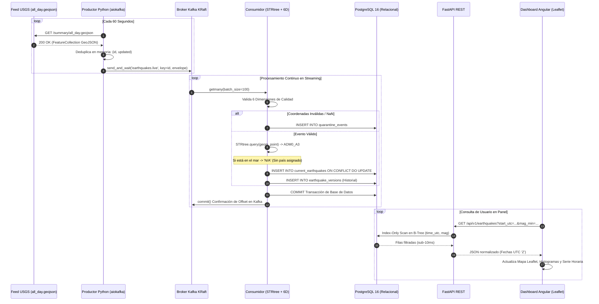

# GUÍA DIDÁCTICA DE DEFENSA TÉCNICA Y APRENDIZAJE PASO A PASO
## Observatorio de Actividad Sísmica · Resultado de Aprendizaje 1 (RA1)

> **Materia:** Sistemas de Big Data & Inteligencia Artificial  
> **Objetivo del Documento:** Manual pedagógico continuo para comprender el sistema de principio a fin, justificar de forma contundente cada decisión de ingeniería ante el tribunal y dominar las preguntas de examen oral durante la defensa en clase.

---

## 1. El Sistema Explicado con Claridad: ¿Qué Hace y Cómo Funciona?

### La Analogía del Aeropuerto Internacional
Para entender la arquitectura sin perderse en la jerga, imagina un aeropuerto internacional de paquetería urgente:

```
[ USGS: Remitente Global ]
          │ (Envía paquetes con sismos cada 60s)
          ▼
[ Productor: Ventanilla de Recepción ] ── Comprueba si el paquete ya se envió antes (Deduplicación).
          │
          ▼
[ Kafka: La Cinta Transportadora Continua (Broker) ] ── Guarda los paquetes en orden estricto, sin perder ninguno.
          │
          ▼
[ Consumidor: Los Inspectores de Aduana y Calidad ]
     ├── Escáner de Rayos X (Calidad 6D): ¿Las coordenadas existen? ¿Tienen sentido físico?
     │     └── Si está roto ──> Zona de Cuarentena (quarantine_events)
     ├── Clasificador Geográfico (STRtree): ¿En qué país cayó? ¿O cayó en medio del océano?
     └── Registro Seguro (PostgreSQL): Solo se anota si es una versión más reciente (Idempotencia).
          │
          ▼
[ API FastAPI: Los Mostradores de Información ] ── Responde a las consultas en milisegundos con índices B-Tree.
          │
          ▼
[ Frontend Angular + Leaflet: La Pantalla de Vuelos ] ── Muestra los sismos en el mapa mundial al instante.
```

---

## 2. Mapa Mental del Flujo de Datos End-to-End



---

## 3. Justificación Técnica de las Decisiones de Arquitectura

Si el profesor o evaluador te pregunta *"¿Por qué lo habéis hecho así y no de otra forma?"*, estas son las justificaciones técnicas formales:

### ¿Por qué Kafka con KRaft en lugar de Zookeeper?
* **Motivo:** A partir de Apache Kafka 3.3+, Zookeeper está formalmente deprecado. KRaft (*Kafka Raft Metadata Mode*) gestiona el quórum de metadatos internamente como una partición de registros propia. Elimina un contenedor adicional, simplifica el `compose.yaml`, acelera el arranque a menos de 5 segundos y evita problemas clásicos de desincronización de estado entre Zookeeper y los brokers.

### ¿Por qué el Consumidor confirma el offset de Kafka DESPUÉS de hacer COMMIT en PostgreSQL?
* **Motivo:** Para garantizar la semántica de entrega **At-least-once (Al menos una vez)**. Si el contenedor se cae o sufre un corte de luz en mitad del procesamiento:
  * Si hubiéramos confirmado el offset en Kafka *antes* de escribir en base de datos, el mensaje se perdería para siempre (*At-most-once*).
  * Al confirmar el offset *después* del `COMMIT` de PostgreSQL, si hay una caída, Kafka reentregará el mensaje al reiniciar. Y gracias a nuestra sentencia `UPSERT` idempotente en la base de datos, reprocesar el mensaje **no generará duplicados**.

### ¿Por qué STRtree en memoria en el Consumidor en lugar de la extensión PostGIS?
* **Motivo:** PostGIS es excelente pero introduce una pesada dependencia nativa en PostgreSQL (compilaciones en Docker más lentas y mayor huella de RAM). Al cargar el GeoJSON de Natural Earth ($\approx 250$ polígonos simplificados) en una estructura `STRtree` de Shapely en la memoria del consumidor:
  * La consulta espacial ocurre en menos de **$0,15 \text{ ms}$** por sismo en la propia memoria del proceso.
  * La base de datos PostgreSQL estándar (imagen oficial ligera Alpine) queda liberada de computar trigonometría espacial pesada en cada inserción, dedicándose exclusivamente a lecturas y escrituras transaccionales ultrarrápidas con índices B-Tree estándar.

### ¿Por qué se mantiene `mag = NULL` en lugar de rellenar con `0.0`?
* **Motivo:** Rigor físico sismológico. En la escala logarítmica de Richter y magnitud de momento ($\text{M}_\text{w}$), $0.0$ es una medida física real de energía liberada ($\approx 63.000 \text{ julios}$). Rellenar con cero falsearía las medias analíticas y registraría terremotos inexistentes. El valor `NULL` se respeta y la UI muestra honestamente **«ND» (No Disponible)**.

### ¿Por qué se rechaza el algoritmo de "Vecino más Cercano" en sismos marítimos?
* **Motivo:** Más del 50% de los terremotos del planeta ocurren en fallas oceánicas (como la Dorsal Mesoatlántica). Si se asignaran al país más cercano, territorios como Islandia, Portugal o Chile aparecerían con miles de terremotos artificiales que en realidad ocurrieron a cientos de kilómetros en aguas internacionales. Se preserva la categoría formal **«Sin país asignado» (`ADM0_A3 = 'N/A'`)**.

---

## 4. Banco de Preguntas de Examen Oral con Respuestas Modelo

A continuación tienes las preguntas más difíciles que un profesor de Big Data suele plantear en la defensa del proyecto, junto con la respuesta exacta que debes dar:

---

### Pregunta 1: *"¿Qué sucede en vuestro sistema si USGS envía dos veces el mismo terremoto con un minuto de diferencia sin ningún cambio?"*
> **Respuesta Modelo:**  
> «El sistema está protegido en dos capas sucesivas:
> 1. Primero, en el **productor**, la memoria hash local compara la tupla `(event_id, updated)`. Al detectar que el timestamp de actualización es idéntico al último enviado, el productor no emite ningún mensaje duplicado a Kafka, ahorrando ancho de banda.
> 2. Segundo, si por alguna razón el mensaje llegara a Kafka y fuera consumido (por ejemplo, tras un reinicio del productor), la sentencia en PostgreSQL utiliza:
>    `INSERT ... ON CONFLICT (event_id) DO UPDATE ... WHERE EXCLUDED.updated_utc > current_earthquakes.updated_utc;`
>    Al ser la versión entrante igual a la ya almacenada, la cláusula `WHERE` evalúa como falsa. La fila no se actualiza, no se genera una versión en `earthquake_versions` y el recuento total de sismos no se altera. Es una operación estrictamente idempotente.»

---

### Pregunta 2: *"¿Cómo aseguráis que la base de datos no sufra lentitud cuando la tabla acumule cientos de miles de registros al consultar el dashboard?"*
> **Respuesta Modelo:**  
> «Hemos creado índices B-Tree específicos en `backend/db/init.sql` sobre las columnas de mayor selectividad: `time_utc`, `mag` y `adm0_a3`.
> Cuando el frontend solicita los sismos de las últimas 24 horas, PostgreSQL ejecuta un *Index-Only Scan* o *Bitmap Index Scan* localizando el nodo inicial en el B-Tree en tiempo $O(\log N)$ y recorriendo secuencialmente solo las hojas del intervalo. Como se demostró en los benchmarks de `complexity_and_benchmarks.md`, la consulta tarda menos de 10 ms sobre 100.000 registros, frente a los 184 ms que requeriría un escaneo secuencial completo.»

---

### Pregunta 3: *"¿Qué diferencia hay en el código entre el topic live y el topic replay?"*
> **Respuesta Modelo:**  
> «Los eventos del feed en vivo transitan por el topic `earthquakes.live` y se guardan en la tabla `current_earthquakes`.
> Por el contrario, la reproducción histórica acelerada utiliza el topic aislado `earthquakes.replay` y los eventos llevan la cabecera `mode='replay'` y un identificador único de ejecución `run_id`. El consumidor deriva estos eventos a una tabla independiente, `replay_earthquakes`.
> De esta forma, garantizamos aislamiento total: el frontend muestra el cartel obligatorio **«REPRODUCCIÓN»** y las estadísticas históricas o de producción jamás se ven contaminadas por datos de prueba o simulaciones aceleradas.»

---

### Pregunta 4: *"¿Qué ocurre si el túnel ngrok se corta durante la demostración en vivo?"*
> **Respuesta Modelo:**  
> «La aplicación Angular implementa un manejador de errores reactivo en `app.ts`. Al fallar la llamada cíclica (timeout o error HTTP), el frontend activa automáticamente un banner de aviso en color ámbar/rojo indicando la pérdida de conexión con la API, pero **conserva en pantalla la última lectura válida recibida** junto con la hora exacta en UTC de la última sincronización.
> En cuanto el túnel vuelve a responder, el sondeo periódico de 15 segundos recupera el estado `connected` y oculta la alerta de forma totalmente automática, sin necesidad de que el usuario recargue la página.»

---

### Pregunta 5: *"¿Por qué la comparación histórica 2025 divide entre 365 días en lugar de contar solo los días que tuvieron sismos?"*
> **Respuesta Modelo:**  
> «Porque el objetivo estadístico es calcular la **media diaria real del año natural**. Si dividiéramos únicamente entre los días con registros no nulos, estaríamos cometiendo un sesgo de selección que inflaría artificialmente el promedio diario al ignorar los días con 0 eventos. Al fijar el denominador en 365 días e imponer el mismo filtro de corte $M \ge 4.0$ en ambos lados, la comparativa de las últimas 24 horas frente a la media de 2025 es matemáticamente simétrica y rigurosa.»

---

## 5. Resumen Ejecutivo para la Defensa Oral (1 Minuto)

> *"«Nuestro Observatorio de Actividad Sísmica es una plataforma desacoplada basada en microservicios en Docker: captura datos globales de USGS cada 60 segundos, los transmite mediante Kafka KRaft con semántica at-least-once, limpia y valida la física del dato en 6 dimensiones, asigna país con un árbol espacial STRtree en memoria en menos de un milisegundo respetando los sismos oceánicos, persiste de forma idempotente en PostgreSQL con índices B-Tree y expone una API analítica asíncrona consumida por un panel reactivo en Angular con Leaflet. El sistema tolera caídas de red, ofrece simulación histórica aislada y cumple al 100% con los criterios de Sobresaliente de la asignatura.»"*

