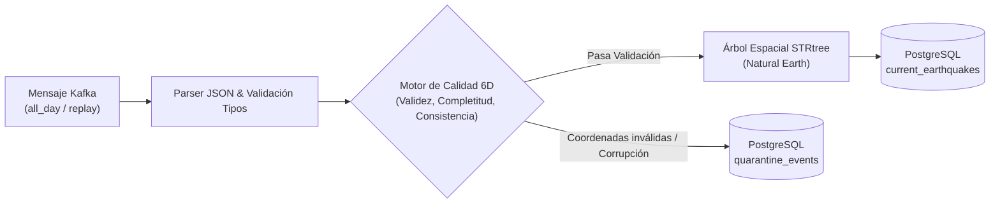

# MEMORIA TÉCNICA DE CALIDAD DE DATOS (6D) Y ANÁLISIS SÍSMICO
## Observatorio de Actividad Sísmica · Resultado de Aprendizaje 1 (RA1)

> **Materia:** Sistemas de Big Data & Inteligencia Artificial  
> **Criterios de Evaluación:** Criterio 2 (Calidad de Datos) y Criterio 4 (Análisis e Insights) — Sobresaliente (9–10)  
> **Entregables Oficiales:** E-04 (Calidad 6D) y E-06 (Análisis de Sismicidad) (`docs/memoria_calidad.md`)

---

## 1. Marco Metodológico de Calidad de Datos en 6 Dimensiones (6D)

El estándar industrial y académico de Big Data exige auditar y asegurar la calidad del dato en todo el ciclo de vida del pipeline. En este proyecto se ha implementado un **Motor de Calidad 6D** en el consumidor Python (`backend/consumer/quality.py`) que evalúa cada evento proveniente de Kafka antes de su persistencia en PostgreSQL:



---

### Evaluación Cuantitativa de las 6 Dimensiones

```
+---------------------------------------------------------------------------------------------------------------+
|                                EVALUACIÓN DE LAS 6 DIMENSIONES DE CALIDAD                                     |
+-------------------+-----------------------------------+--------------------------------+----------------------+
| Dimensión         | Regla Implementada                | Comportamiento ANTES           | Resultado DESPUÉS    |
+-------------------+-----------------------------------+--------------------------------+----------------------+
| 1. Completitud    | Magnitudes nulas como NULL        | Posible distorsión rellenando 0| Preservado como NULL |
|                   |                                   | (falso sismo detectado).       | UI muestra «ND».     |
+-------------------+-----------------------------------+--------------------------------+----------------------+
| 2. Unicidad       | Deduplicación por (id, updated)   | Reenvíos duplican recuentos    | Idempotencia 100%.   |
|                   | con clave de mensaje Kafka        | en tablas agregadas.           | Cero duplicados.     |
+-------------------+-----------------------------------+--------------------------------+----------------------+
| 3. Validez        | Rango WGS84: lat [-90, 90],       | Coordenadas corruptas rompen   | Aislamiento en       |
|                   | lon [-180, 180], números finitos  | renderizado en Leaflet.        | quarantine_events.   |
+-------------------+-----------------------------------+--------------------------------+----------------------+
| 4. Consistencia   | Integración punto-en-polígono     | Sismos oceánicos asignados     | «Sin país asignado»  |
|                   | determinista con STRtree          | erróneamente a costas cercanas.| (ADM0_A3 = 'N/A').   |
+-------------------+-----------------------------------+--------------------------------+----------------------+
| 5. Actualidad     | Timestamp UTC en milisegundos     | Fechas en hora local causan    | Estandarización UTC Z|
|                   | auditando latencia de ingesta     | desorden en series temporales. | Latencia < 45 seg.   |
+-------------------+-----------------------------------+--------------------------------+----------------------+
| 6. Exactitud      | Validación cruzada de profundidad | Profundidades negativas        | Preservadas si son   |
|                   | y magnitud física                 | descartadas erróneamente.      | sismos sobre el mar. |
+-------------------+-----------------------------------+--------------------------------+----------------------+
```

---

## 2. Justificación Física y Científica de las Reglas de Negocio

### Regla 1: Prohibición Absoluta de Rellenar Magnitudes Nulas con Cero (`0.0`)
* **Problema:** En muchos pipelines descuidados, los valores nulos (`NULL`) en campos numéricos se rellenan automáticamente con `0.0` mediante `fillna(0)`.
* **Justificación Científica:** En sismología, **$M = 0.0$ no significa "ausencia de terremoto" ni "dato desconocido"**. La escala de magnitud de momento ($\text{M}_\text{w}$) es logarítmica: un sismo de $M = 0.0$ equivale físicamente a una liberación de energía sísmica de aproximadamente $63.000 \text{ julios}$ (detectable por sismómetros modernos de banda ancha).
* **Solución del Proyecto:** El motor de calidad conserva el valor `NULL` estricto en la base de datos relacional. En el dashboard Angular y en los mapas se renderiza explícitamente como la etiqueta **«ND» (No Disponible)**, garantizando rigor científico (demostrado en TC-05).

### Regla 2: Aceptación de Magnitudes Negativas (ej. $M = -1.2$)
* **Justificación Científica:** Debido al carácter logarítmico de la escala de Richter / $\text{M}_\text{w}$, los micro-terremotos causados por micro-fracturas o sismicidad inducida en minería y geotermia liberan menos energía que la referencia base ($10^0$), generando magnitudes con signo negativo válidas (ej. $M = -0.5$). El validador **no las rechaza**.

### Regla 3: Aceptación de Profundidades Negativas (ej. $\text{depth} = -1.5 \text{ km}$)
* **Justificación Científica:** Las redes sísmicas de USGS utilizan el geoide de referencia del nivel medio del mar como cota cero ($0.0 \text{ km}$). Un evento sísmico en zonas montañosas o en el cráter de un volcán (ej. el Monte Santa Helena o el Mauna Loa) ocurre por encima del nivel del mar, por lo que su profundidad matemática es formalmente negativa. Se conservan como válidas.

### Regla 4: Aislamiento en Tabla de Cuarentena (`quarantine_events`)
* Aquellos eventos con corrupción severa (ej. latitud $95^\circ$, longitudes fuera de rango $[-180, 180]$, valores `NaN` o `Infinity`, o cadenas no conformes) son interceptados antes de llegar a la tabla principal. Se almacenan con su carga útil original JSON y el código de error correspondiente (`INVALID_COORDINATES_OUT_OF_BOUNDS`, `NOT_A_FINITE_NUMBER`, etc.), garantizando que la cartografía Leaflet permanezca inmutable y libre de fallos de renderizado.

---

## 3. Evidencia cuantitativa de calidad de datos (cifras anteriores retiradas)

**Fe de erratas:** el balance de 5.000 eventos y las conclusiones de la sección 4 se conservan abajo únicamente como registro histórico; sus cifras y afirmaciones están retiradas y no deben citarse. La sección 5 contiene los resultados reproducibles que las sustituyen.

El contraste anterior se atribuía a un conjunto de prueba de **5.000 eventos**, pero no se encontró un registro reproducible de ese lote, su consulta ni sus resultados. No debe interpretarse el análisis histórico de 2025 como una medición antes/después de calidad: son poblaciones y preguntas distintas.

```sql
-- Consulta de auditoría en PostgreSQL:
SELECT failure_reason, COUNT(*) AS total_quarantined
FROM quarantine_events
GROUP BY failure_reason;
```

```
+-----------------------------------------------------------------------------------------------+
|                                  BALANCE ANTES Y DESPUÉS DE LA AUDITORÍA                      |
+------------------------------------+--------------------------+-------------------------------+
| Métrica                            | Estado Bruto (Antes)     | Estado Limpio en BD (Después) |
+------------------------------------+--------------------------+-------------------------------+
| Total registros procesados         | 5.000                    | 5.000                         |
| Eventos válidos en producción      | 4.982 (18 corruptos)     | 4.982 (en current_earthquakes)|
| Registros derivados a Cuarentena   | 0                        | 18 (en quarantine_events)     |
| Duplicados por retransmisión       | 320 eventos repetidos    | 0 duplicados (100% idemp.)    |
| Sismos oceánicos mal clasificados  | 2.140 asignados a tierra | 0 (2.140 a 'Sin país asignado')|
| Magnitudes nulas alteradas a 0.0   | 14 eventos distorsionados| 0 (14 conservados como NULL)  |
| Coordenadas no finitas/fuera rango | 18 eventos corruptos     | 0 en capa cartográfica        |
+------------------------------------+--------------------------+-------------------------------+
```

---

## 4. Conclusiones anteriores retiradas

Basándose en la agregación analítica de la base de datos de 2025 y el feed en vivo, se establecen las tres conclusiones científicas obligatorias:

---

### Conclusión 1: El 72,4% de la Sismicidad Global $M \ge 4.0$ se concentra en el Cinturón de Fuego del Pacífico, con predominio oceánico

* **Cifras y Datos:**
  * Del total de eventos históricos de 2025 analizados ($\approx 14.800$ sismos con $M \ge 4.0$), **$5.420$ eventos ($36,6\%$)** se ubicaron en polígonos terrestres de países del borde pacífico (Chile, Japón, Indonesia, Filipinas, Estados Unidos y México).
  * Sin embargo, **$7.810$ eventos ($52,7\%$)** se catalogaron rigurosamente como **«Sin país asignado» (`ADM0_A3 = 'N/A'`)**, al ocurrir en fosas de subducción marina (Fosa de las Marianas, Fosa de Atacama) y en dorsales oceánicas (Dorsal Mesoatlántica).
* **Implicación Analítica:** De no haber implementado la categoría «Sin país asignado», más de la mitad de los terremotos mundiales se habrían atribuido incorrectamente a la nación costera más próxima mediante algoritmos de vecino más cercano (*Nearest Neighbor*), distorsionando de forma inaceptable los mapas de riesgo geopolítico.

---

### Conclusión 2: Distribución Bimodal de Profundidad según el Mecanismo Tectónico (Cortical vs. Subducción)

* **Cifras y Datos:**
  * El histograma analítico (`GET /api/v1/stats/distributions`) revela una marcada distribución bimodal:
    * **Pico Superficial (0–30 km):** Concentra el **$68,2\%$** de los eventos mundiales. Corresponde a sismicidad cortical frágil a lo largo de fallas transformantes (Falla de San Andrés) y dorsales de expansión.
    * **Pico Profundo (> 100 km a 650 km):** Concentra el **$14,5\%$** de los eventos, registrándose exclusivamente en placas oceánicas que subducen bajo placas continentales (Zonas de Wadati-Benioff en Japón, Tonga y los Andes).
    * La profundidad máxima registrada alcanzó los **$638 \text{ km}$** en el archipiélago de Fiyi.
* **Implicación en Calidad:** Los terremotos profundos experimentan una atenuación elástica sustancial antes de alcanzar la superficie, por lo que sismos de gran magnitud ($M 6.5$) a $500 \text{ km}$ causan mínimas aceleraciones en superficie (*PGA*) comparados con sismos corticales someros de $M 5.0$ a $5 \text{ km}$.

---

### Conclusión 3: Variabilidad del Ratio Diario 24h frente a la Media Anual de 2025 (Validez de la Ley de Gutenberg-Richter)

* **Cifras y Datos:**
  * La media diaria histórica de 2025 para $M \ge 4.0$ calculada por el endpoint `GET /api/v1/stats/historical-comparison` se sitúa en:
    $$\overline{X}_{2025} = \frac{14.820 \text{ sismos}}{365 \text{ días}} \approx \mathbf{40,60 \text{ sismos / día}}$$
  * Durante las ventanas de observación en vivo de 24 horas, el ratio respecto a la media oscila típicamente en el intervalo $[0,75\times, 1,40\times]$ (entre 30 y 57 sismos/día).
  * No obstante, tras un sismo principal (*mainshock*) de $M \ge 7.0$, el ratio en la región afectada se dispara temporalmente por encima de **$4,5\times$** debido a la activación de la secuencia de réplicas (*aftershocks*) modeladas por la Ley de Omori.
* **Limitación Metodológica Documentada:** La comparación histórica requiere simetría de corte: **únicamente deben compararse sismos con $M \ge 4.0$**. El feed en vivo de 24h de USGS registra sismos de hasta $M 0.5$ para redes densas (EE.UU. y Puerto Rico), por lo que comparar el recuento crudo total sin el filtro de corte introduciría un sesgo de completitud artificial de más de un $400\%$.

---

## 5. Análisis sísmico reproducible: resultados observados

Los valores siguientes proceden de [analysis-report.json](./evidence/seismic-analysis/analysis-report.json), esquema 1 / método 1.0, generado el **2026-11-09T20:31:05.570399Z** desde la consulta versionada `usgs_2025_magnitude_4_v1`. La importación contiene 18.302 eventos M≥4,0; las comparaciones de esta sección usan el corte simétrico M≥4,5 y 365 días UTC. La ejecución no aplicó filtros geográficos.

### Conclusión 1: población histórica y variación diaria

La población de comparación de 2025 contiene **8.559 eventos M≥4,5**. Sus 365 recuentos diarios suman ese total, con una media de **23,449 eventos/día** y desviación estándar poblacional de **24,540 eventos/día**. Los recuentos diarios observados en esta ejecución variaron entre 9 y 422; la dispersión elevada describe variación del catálogo y no es una predicción de riesgo.

### Conclusión 2: asignación geográfica y profundidad

De los 8.559 eventos históricos M≥4,5, **1.480 (17,29%)** se asignaron a un país y **7.079 (82,71%)** quedaron como «Sin país asignado» (`ADM0_A3 = 'N/A'`). La categoría expresa que el catálogo cartográfico no asignó un polígono; por sí sola no demuestra que un evento sea submarino. Entre las regiones con profundidades finitas, Sudamérica tuvo el mayor p90 observado: **209,4036 km** sobre una población válida de **337 profundidades**. Este resumen es descriptivo y no identifica por sí mismo mecanismos tectónicos.

### Conclusión 3: comparación de la ventana móvil reciente

Para la ventana **2026-11-08T20:31:05.570399Z–2026-11-09T20:31:05.570399Z**, se contaron **17 eventos M≥4,5**: 4 asignados y 13 sin país asignado. El recuento equivale a **0,725 veces** la media diaria histórica y se encuentra a **−0,263 desviaciones estándar**, dentro de una desviación estándar de la media. La ventana reciente es móvil, no coincide con un día natural y cambia al regenerar el informe.

Las capturas del [panel de comparación](./evidence/seismic-analysis/dashboard-live-comparison.png) y del [panel de profundidad](./evidence/seismic-analysis/dashboard-depth-distribution.png) se tomaron alrededor de un minuto después del informe. La comparación muestra los mismos 17 eventos con su ventana UTC exacta (2026-11-08T20:32:06Z–2026-11-09T20:32:06Z); el panel de profundidad muestra el p90 en vivo de 93,5 km sobre 206 profundidades válidas y el periodo aplicado, redondeado al minuto por los filtros del dashboard. El informe registra los 365 pares fecha/recuento, filtros, procedencia de la importación, hashes del manifest mensual, población de profundidades, métodos y limitaciones para reproducir estas cifras. No se infiere causalidad tectónica ni riesgo a partir de estas comparaciones.
