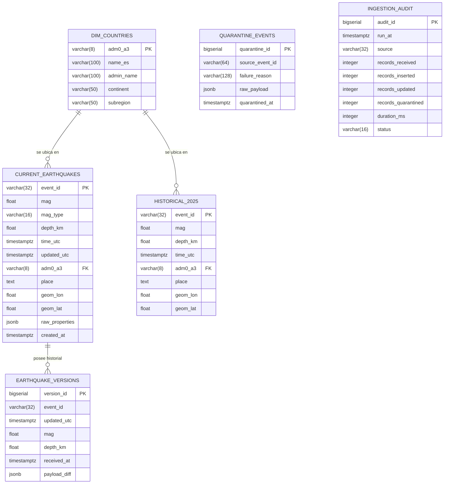
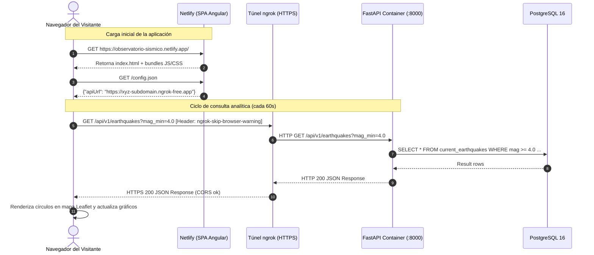

# PLAN TÉCNICO Y ARQUITECTURA DE SISTEMA

> **Feature ID:** `001-observatorio-sismico`  
> **Fase:** Plan de Arquitectura e Implementación Técnica (`plan.md`)  
> **Origen del documento:** Formalización de [`Fuente_inicial.md`](../../Fuente_inicial.md)  
> **Estado:** Aprobado / Plan Director  

---

## 1. Visión General de la Arquitectura

El sistema se estructura mediante un desacoplamiento estricto en tres capas: **Ingesta y Procesamiento Asíncrono (Event-Driven)**, **Persistencia Relacional y Exposición API**, y **Consumo y Visualización Frontend (SPA)**.

```mermaid
flowchart TD
    subgraph Fuentes ["Fuentes Externas de Datos"]
        USGS_Live["USGS Feed Live (24h GeoJSON)\nHTTP GET cada 60s"]
        USGS_Hist["USGS Catalog (Año 2025)\nFDSNWS API (Partición mensual)"]
        NE_Geo["Natural Earth Catálogo\npaises.geojson (WGS84)"]
    end

    subgraph DockerCompose ["Entorno Docker Compose Local (Red Aislada)"]
        subgraph S1 ["1. Servicio Productor"]
            Prod["Python 3.11 + aiokafka\nExtractor, deduplicador en memoria\ny gestor de reintentos"]
        end

        subgraph S2 ["2. Broker de Mensajería"]
            Kafka["Apache Kafka 3.7+ (KRaft)\nTopics: earthquakes.live\nearthquakes.replay"]
        end

        subgraph S3 ["3. Servicio Consumidor"]
            Cons["Python 3.11 + aiokafka + Shapely\nValidación (6D) + Punto-en-Polígono\nIdempotent DB Writer"]
        end

        subgraph S4 ["4. Almacenamiento Persistente"]
            Postgres[("PostgreSQL 16\n- current_earthquakes\n- earthquake_versions\n- quarantine_events\n- historical_2025\n- dim_countries")]
        end

        subgraph S5 ["5. API de Consulta"]
            FastAPI["Python 3.11 + FastAPI + asyncpg\nEndpoints analíticos REST\nCORS + ngrok bypass"]
        end
    end

    subgraph PerimetroSeguro ["Perímetro Externo & Visualización"]
        Ngrok["ngrok HTTPS Tunnel\nTerminación TLS pública\n(127.0.0.1:8000 o contenedor)"]
        Netlify["Netlify CDN (Hosting SPA)"]
        Angular["Panel Angular + Leaflet\nMapa reactivo, histogramas,\nventanas UTC y métricas"]
    end

    USGS_Live -->|GET 60s| Prod
    USGS_Hist -.->|Carga inicial / Replay| Prod
    NE_Geo -->|Carga en memoria + STRtree| Cons
    NE_Geo -.->|Precarga DDL| Postgres

    Prod -->|Publish (Key: event_id)| Kafka
    Kafka -->|Consume (At-least-once)| Cons
    Cons -->|1. Transacción SQL| Postgres
    Cons -->|2. Commit Offset tras DB| Kafka

    FastAPI -->|Consultas SQL analíticas| Postgres
    FastAPI <-->|HTTP Local| Ngrok
    Ngrok <-->|Túnel Seguro HTTPS| Angular
    Netlify -->|Sirve archivos estáticos| Angular
```

---

## 2. Especificación Detallada de Servicios Docker (Compose)

### 2.1 Servicio 1: `productor` (Python + aiokafka)
- **Imagen:** Python 3.11-slim (`Dockerfile` dedicado o multi-stage compartido).
- **Responsabilidades:**
  1. Ejecución periódica (bucle asíncrono con `asyncio.sleep(60)`).
  2. Descarga del endpoint `all_day.geojson` mediante cliente HTTP asíncrono (`httpx`).
  3. Filtrado por `properties.type == "earthquake"`.
  4. Deduplicación antes de emitir: mantenimiento de un registro local o verificación de tupla `(id, updated)` para emitir exclusivamente sismos nuevos o revisiones con timestamp `updated` posterior.
  5. Empaquetado del mensaje en un sobre (*envelope*) estándar:
     ```json
     {
       "source": "usgs_live",
       "ingested_at": "2026-10-29T18:40:00Z",
       "mode": "live",
       "event_id": "us7000abcd",
       "updated": 1730227100000,
       "payload": { "...GeoJSON Feature crudo..." }
     }
     ```
  6. Envío particionado a Kafka con clave `key = event_id.encode('utf-8')`.
  7. Confirmación de entrega mediante `await producer.send_and_wait(topic, key=..., value=...)`.
  8. Gestión de excepciones: HTTP 429/5xx con *exponential backoff* (reintentos 2s, 4s, 8s...) y registro de auditoría.

### 2.2 Servicio 2: `broker` (Apache Kafka)
- **Imagen:** `apache/kafka:3.7.0` o `confluentinc/cp-kafka:7.6.0` en modo KRaft (sin necesidad de ZooKeeper, ultra ligero y eficiente).
- **Configuración de Topics:**
  - `earthquakes.live`: Particiones = 3, Factor de réplica = 1, Retención de log = 48 horas (`log.retention.hours=48`), compactación habilitada opcionalmente (`cleanup.policy=delete`).
  - `earthquakes.replay`: Topic dedicado para las simulaciones y demostraciones de reproducción histórica acelerada.
- **Políticas de red:** Listener interno `PLAINTEXT://kafka:9092` accesible únicamente dentro de la red Compose. Listener opcional en host `PLAINTEXT_HOST://localhost:29092` únicamente para depuración manual si se requiere.

### 2.3 Servicio 3: `consumidor` (Python + aiokafka + Shapely)
- **Imagen:** Python 3.11-slim con librerías geoespaciales (`shapely`, `geopandas`, `asyncpg`, `pydantic`).
- **Ciclo de Ingesta y Procesamiento:**
  1. **Precarga cartográfica:** Al arrancar, parsea `paises.geojson` y construye un índice espacial en memoria mediante `shapely.strtree.STRtree` para operaciones punto-en-polígono ultrarrápidas ($O(\log N)$).
  2. **Consumo de mensajes:** Suscripción al grupo de consumidores `observatorio-consumer-group`.
  3. **Control de Calidad (Motor 6D):**
     - Si falla validación crítica (coordenadas no finitas o fuera de rango $\pm 180 / \pm 90$) $\rightarrow$ Inserción en `quarantine_events`.
     - Si magnitud es nula $\rightarrow$ Se mantiene como `NULL` (no descartar, no rellenar con 0).
  4. **Enriquecimiento Espacial:** Localización de `(geometry.coordinates[0], geometry.coordinates[1])` en el árbol espacial. Asignación de `ADM0_A3`, `NAME_ES`, `CONTINENT`, `SUBREGION`. Si no hay intersección $\rightarrow$ `ADM0_A3 = 'N/A'`, país = `'Sin país asignado'`.
  5. **Escritura Idempotente Transaccional (PostgreSQL):**
     - Escritura en `current_earthquakes` mediante `UPSERT` con cláusula temporal estricta:
       ```sql
       INSERT INTO current_earthquakes (event_id, mag, mag_type, depth_km, time_utc, updated_utc, adm0_a3, place, geom_lon, geom_lat, raw_properties)
       VALUES ($1, $2, $3, $4, $5, $6, $7, $8, $9, $10, $11)
       ON CONFLICT (event_id) DO UPDATE
       SET mag = EXCLUDED.mag,
           depth_km = EXCLUDED.depth_km,
           updated_utc = EXCLUDED.updated_utc,
           adm0_a3 = EXCLUDED.adm0_a3,
           raw_properties = EXCLUDED.raw_properties
       WHERE EXCLUDED.updated_utc > current_earthquakes.updated_utc;
       ```
     - Registro paralelo en `earthquake_versions` para trazabilidad de la revisión.
  6. **Commit de Offset:** Se invoca `await consumer.commit()` **después** del commit de PostgreSQL. Si la base de datos falla, la transacción revierte y Kafka volverá a entregar el mensaje (tolerancia a caídas).

### 2.4 Servicio 4: `almacenamiento` (PostgreSQL 16)
- **Imagen:** `postgres:16-alpine`.
- **Volumen persistente:** `postgres_data:/var/lib/postgresql/data`.
- **Estructura del Esquema:**
  - `init.sql`: Script de inicialización montado en `/docker-entrypoint-initdb.d/init.sql`.
  - Extensiones: `postgis` opcional si se desea, o cálculo nativo con columnas `DOUBLE PRECISION` y tipos geométricos estándar.

### 2.5 Servicio 5: `api` (Python + FastAPI)
- **Imagen:** Python 3.11-slim + `fastapi` + `uvicorn[standard]` + `asyncpg`.
- **Configuración de Red:** Escucha en `0.0.0.0:8000` dentro del contenedor.
- **Conectividad:** Pool de conexiones asíncrono con `asyncpg.create_pool(min_size=5, max_size=20)`.
- **Middleware:** CORS configurado con orígenes permitidos explícitos (Netlify production URL, Netlify deploy previews y `http://localhost:4200`). Cabeceras permitidas incluyendo `ngrok-skip-browser-warning`.

---

## 3. Modelo de Datos Relacional y Estrategia de Índices



### 3.1 Estrategia de Indexación Fisiológica
1. `idx_current_earthquakes_time`: Índice B-Tree sobre `(time_utc DESC)` $\rightarrow$ Acelera ventanas móviles de 24 horas y series temporales horarias.
2. `idx_current_earthquakes_mag`: Índice B-Tree sobre `(mag)` $\rightarrow$ Filtro inmediato de magnitudes $\ge 4.0$.
3. `idx_current_earthquakes_adm0`: Índice B-Tree sobre `(adm0_a3)` $\rightarrow$ Optimiza agrupaciones geoespaciales por país.
4. `idx_historical_time_mag`: Índice compuesto sobre `HISTORICAL_2025(time_utc, mag)` $\rightarrow$ Resuelve el denominador y la media diaria histórica en menos de 10 ms.
5. `idx_versions_lookup`: Índice compuesto sobre `EARTHQUAKE_VERSIONS(event_id, updated_utc DESC)` $\rightarrow$ Búsqueda ultrarrápida del historial de revisiones de un sismo.

---

## 4. Orquestación y Arranque (`compose.yaml`)

### 4.1 Grafo de Dependencias con Healthchecks
El orden de arranque de Docker por sí solo no garantiza que Kafka o PostgreSQL admitan conexiones. Es obligatorio declarar comprobaciones de salud:

```yaml
services:
  almacenamiento:
    image: postgres:16-alpine
    healthcheck:
      test: ["CMD-SHELL", "pg_isready -U postgres -d sismos_db"]
      interval: 5s
      timeout: 5s
      retries: 5

  broker:
    image: apache/kafka:3.7.0
    healthcheck:
      test: ["CMD-SHELL", "/opt/kafka/bin/kafka-topics.sh --bootstrap-server localhost:9092 --list"]
      interval: 10s
      timeout: 5s
      retries: 5

  consumidor:
    build:
      context: ./backend
      dockerfile: Dockerfile.consumer
    depends_on:
      almacenamiento:
        condition: service_healthy
      broker:
        condition: service_healthy

  productor:
    build:
      context: ./backend
      dockerfile: Dockerfile.producer
    depends_on:
      broker:
        condition: service_healthy

  api:
    build:
      context: ./backend
      dockerfile: Dockerfile.api
    ports:
      - "127.0.0.1:8000:8000"
    depends_on:
      almacenamiento:
        condition: service_healthy
```

---

## 5. Integración del Túnel ngrok y Despliegue en Netlify



---

## 6. Arquitectura del Modo Reproducción Histórica (`Replay`)

Para la demostración técnica evaluable:
1. El comando de reproducción se ejecuta dentro del contenedor productor o como tarea auxiliar:
   ```bash
   docker compose exec productor python -m scripts.historical_replay --speed 120 --month 2025-06
   ```
2. Lee los datos históricos ya descargados de 2025, inyecta casos de prueba controlados (ej. evento con versión inicial $M 4.2$ y posterior revisión a $M 4.8$, un sismo marítimo y un sismo duplicado).
3. Publica los eventos en Kafka hacia `earthquakes.replay` o con metadatos `mode="replay"`.
4. El consumidor procesa estos eventos registrándolos en un esquema/tabla aislada `replay_earthquakes` o marcados con flag de simulación.
5. La API dispone del endpoint `/api/v1/replay/state` y la interfaz Angular activa la cabecera destacada en color amarillo/ámbar con el texto **«MODO REPRODUCCIÓN HISTÓRICA ACTIVO»**.
