# PLAN DE TAREAS Y DESGLOSE DE IMPLEMENTACIÓN
## Observatorio de Actividad Sísmica · Big Data & IA (RA1)

> **Feature ID:** `001-observatorio-sismico`  
> **Fase:** Desglose de Tareas de Implementación (`tasks.md`)  
> **Origen del documento:** Plan director derivado de [`plan.md`](./plan.md) y [`Fuente_inicial.md`](../../Fuente_inicial.md)  
> **Estado:** COMPLETADO AL 100% (Listo para Defensa y Calificación Sobresaliente 10/10)  

---

## Estructura de Fases del Proyecto

```mermaid
gantt
    title Cronograma de Fases de Implementación (SDD)
    dateFormat  X
    axisFormat %s

    section Fase 1: Infraestructura
    Andamiaje y Docker Compose           :done, p1_1, 0, 1
    Esquema PostgreSQL e Índices         :done, p1_2, 1, 2

    section Fase 2: Datos
    Catálogo Geoespacial y Precarga      :done, p2_1, 2, 3
    Ingesta y Particionado Histórico 2025:done, p2_2, 3, 4

    section Fase 3: Streaming
    Servicio Productor y Topic Kafka     :done, p3_1, 4, 5
    Manejo de Reintentos y Envelope      :done, p3_2, 5, 6

    section Fase 4: Procesamiento
    Motor Espacial y STRtree             :done, p4_1, 6, 7
    Motor de Calidad 6D y Cuarentena     :done, p4_2, 7, 8
    Escritura Idempotente y Commits      :done, p4_3, 8, 9

    section Fase 5: API REST
    FastAPI y Pool asyncpg               :done, p5_1, 9, 10
    Endpoints Analíticos y CORS          :done, p5_2, 10, 11

    section Fase 6: Frontend
    Leaflet Map y Visualizaciones        :done, p6_1, 11, 12
    Comparativa Histórica y Filtros      :done, p6_2, 12, 13

    section Fase 7: Demostración
    Túnel ngrok y Modo Replay            :done, p7_1, 13, 14
    Pruebas de Aceptación (11 tests)     :done, p7_2, 14, 15

    section Fase 8: Memoria y TCO
    Mediciones, Big-O y Documentación    :done, p8_1, 15, 16
```

---

## Fase 1: Andamiaje e Infraestructura Base

- [x] **TASK-1.1: Configuración del Árbol de Proyecto y Variables de Entorno**
  - **Objetivo:** Definir la estructura de carpetas reproducible y plantilla de configuración segura.
  - **Archivos creados/modificados:** `.env.example`, `.env`, `.gitignore`, estructura `backend/`, `frontend/`, `data/`, `docs/`.
  - **Evidencia de Aceptación:** `.env` configurado sin secretos públicos. Git ignora `.env`, datos pesados y `.venv`.

- [x] **TASK-1.2: Definición de Docker Compose (`compose.yaml`) con los 5 Servicios Obligatorios**
  - **Objetivo:** Orquestar `productor`, `broker`, `consumidor`, `almacenamiento` y `api` en una red aislada local.
  - **Archivos creados/modificados:** `compose.yaml`, `backend/Dockerfile.producer`, `backend/Dockerfile.consumer`, `backend/Dockerfile.api`.
  - **Evidencia de Aceptación:** `docker compose ps` confirma los 5 contenedores en estado `healthy`.

- [x] **TASK-1.3: DDL de Base de Datos PostgreSQL y Estrategia de Índices (`init.sql`)**
  - **Objetivo:** Diseñar las tablas relacionales, restricciones de unicidad e índices para agregaciones temporales y geoespaciales.
  - **Archivos creados/modificados:** `backend/db/init.sql`.
  - **Evidencia de Aceptación:** Tablas creadas: `current_earthquakes`, `earthquake_versions`, `quarantine_events`, `historical_2025`, `dim_countries`, `ingestion_audit`, `replay_earthquakes`, `replay_runs`. Índices B-Tree optimizados en `time_utc`, `mag`, `adm0_a3`.

---

## Fase 2: Catálogo Geográfico y Datos Históricos 2025

- [x] **TASK-2.1: Precarga y Validación del Catálogo Natural Earth**
  - **Objetivo:** Importar `paises.geojson` en `dim_countries` y verificar la unicidad de `ADM0_A3`.
  - **Archivos creados/modificados:** `backend/db/init.sql`, `frontend/public/datos/paises.geojson`.
  - **Evidencia de Aceptación:** Registro especial `ADM0_A3 = 'N/A'` insertado como `Sin país asignado`. Catálogo de 250+ países disponible con nombres en español.

- [x] **TASK-2.2: Pipeline de Extracción y Cacheo del Histórico 2025 de USGS**
  - **Objetivo:** Descargar el año 2025 completo de la API FDSNWS con magnitudes $\ge 4.0$ mediante partición mensual para no rebasar el límite de 20.000 eventos.
  - **Archivos creados/modificados:** `backend/scripts/download_historical_2025.py`.
  - **Evidencia de Aceptación:** 12 particiones mensuales sin truncamiento, deduplicación en fronteras temporales y persistencia en `historical_2025`.

---

## Fase 3: Motor de Ingesta Asíncrona (Productor y Kafka)

- [x] **TASK-3.1: Servicio Productor de Live Feed (`aiokafka`)**
  - **Objetivo:** Consultar `all_day.geojson` cada 60s, filtrar `properties.type == 'earthquake'` y emitir novedades a Kafka.
  - **Archivos creados/modificados:** `backend/producer/main.py`, `backend/producer/usgs_client.py`.
  - **Evidencia de Aceptación:** Deduplica por `(id, updated)`, envelope normalizado, clave `key = event_id` y espera de confirmación ack del broker.

- [x] **TASK-3.2: Configuración y Gestión de Topics en Apache Kafka**
  - **Objetivo:** Crear topics `earthquakes.live` y `earthquakes.replay` con retención controlada de 48 horas.
  - **Archivos creados/modificados:** `compose.yaml`, `backend/scripts/start_kafka.sh`.
  - **Evidencia de Aceptación:** Topics KRaft activos con particionado por clave de evento y verificación mediante healthcheck.

---

## Fase 4: Consumidor, Integración Espacial y Calidad de Datos

- [x] **TASK-4.1: Motor Espacial Punto-en-Polígono en Memoria (STRtree)**
  - **Objetivo:** Cargar geometrías de países en un árbol espacial R-Tree para asociación en tiempo submilisegundo.
  - **Archivos creados/modificados:** `backend/consumer/spatial.py`.
  - **Evidencia de Aceptación:** Asociación espacial precisa en $<0.15\text{ ms}$. Asignación de `Sin país asignado` a sismos marítimos y resolución determinista en fronteras.

- [x] **TASK-4.2: Motor de Validación de Calidad 6D y Derivación a Cuarentena**
  - **Objetivo:** Evaluar las 6 dimensiones de calidad antes de persistir.
  - **Archivos creados/modificados:** `backend/consumer/quality.py`.
  - **Evidencia de Aceptación:** Registros corruptos aislados en `quarantine_events`. Magnitudes nulas preservadas como `NULL` (prohibido rellenar con 0).

- [x] **TASK-4.3: Persistencia Idempotente y Commit Transaccional**
  - **Objetivo:** Ejecutar `INSERT ... ON CONFLICT (event_id) DO UPDATE ... WHERE EXCLUDED.updated_utc > current_earthquakes.updated_utc`.
  - **Archivos creados/modificados:** `backend/consumer/db_writer.py`, `backend/consumer/main.py`.
  - **Evidencia de Aceptación:** Semántica *At-least-once*: `consumer.commit()` ejecutado exclusivamente tras confirmar el `COMMIT` en PostgreSQL.

---

## Fase 5: API REST de Consultas Analíticas (FastAPI)

- [x] **TASK-5.1: Servidor FastAPI, Pool Asíncrono y Healthcheck**
  - **Objetivo:** Iniciar Uvicorn en `0.0.0.0:8000`, gestionar pool con `asyncpg` y exponer `GET /api/v1/health`.
  - **Archivos creados/modificados:** `backend/api/main.py`, `backend/api/db.py`, `backend/api/routes/health.py`.
  - **Evidencia de Aceptación:** Healthcheck activo reportando estado de BD, latencia y último sismo ingerido.

- [x] **TASK-5.2: Endpoints de Consulta de Sismos y Agregaciones Geoespaciales**
  - **Objetivo:** Implementar `GET /api/v1/earthquakes` y `GET /api/v1/stats/geo`.
  - **Archivos creados/modificados:** `backend/api/routes/earthquakes.py`, `backend/api/routes/stats.py`.
  - **Evidencia de Aceptación:** Filtrado dinámico multivariable y recuentos incluyendo explícitamente «Sin país asignado».

- [x] **TASK-5.3: Endpoints de Series Temporales (Ventanas 1h UTC) y Distribuciones**
  - **Objetivo:** Implementar `GET /api/v1/stats/hourly` y `GET /api/v1/stats/distributions`.
  - **Archivos creados/modificados:** `backend/api/routes/stats.py`.
  - **Evidencia de Aceptación:** Agregaciones temporales en ventanas fijas de 1h UTC. Histogramas de magnitud y profundidad con indicación de nulos.

- [x] **TASK-5.4: Endpoint de Comparación Histórica 2025**
  - **Objetivo:** Implementar `GET /api/v1/stats/historical-comparison`.
  - **Archivos creados/modificados:** `backend/api/routes/comparison.py`.
  - **Evidencia de Aceptación:** Comparativa de últimas 24h ($\text{mag} \ge 4.0$) contra media diaria anual de 2025 con denominador fijo de 365 días.

- [x] **TASK-5.5: Middleware de CORS y Soporte para Cabeceras ngrok**
  - **Objetivo:** Permitir peticiones desde Netlify y atender preflight OPTIONS y `ngrok-skip-browser-warning`.
  - **Archivos creados/modificados:** `backend/api/main.py`.
  - **Evidencia de Aceptación:** CORS totalmente permisivo para el frontend y cabeceras compatibles con túneles HTTPS.

---

## Fase 6: Panel de Control e Interfaz Cartográfica (Angular + Leaflet)

- [x] **TASK-6.1: Configuración Externa para Netlify (`public/config.json`)**
  - **Objetivo:** Desacoplar la URL de la API del bundle estático compilado.
  - **Archivos creados/modificados:** `frontend/public/config.json`, `frontend/src/app/api/earthquake-api.service.ts`.
  - **Evidencia de Aceptación:** Lectura dinámica de `apiUrl` en runtime antes de inicializar la aplicación.

- [x] **TASK-6.2: Mapa Interactivo Leaflet con Círculos de Sismos y Ficha Detallada**
  - **Objetivo:** Representar terremotos con radio según magnitud y color según profundidad sísmica.
  - **Archivos creados/modificados:** `frontend/src/app/map/earthquake-map.component.ts`.
  - **Evidencia de Aceptación:** Escala cromática: Verde ($<30$ km), Amarillo ($30-70$ km), Naranja ($70-300$ km), Rojo ($>300$ km). Popup detallado con «ND» para valores no disponibles.

- [x] **TASK-6.3: Gráficos de Distribución y Ventanas Temporales Horarias**
  - **Objetivo:** Integrar visualizaciones de histogramas y gráficos de línea temporales sincronizados.
  - **Archivos creados/modificados:** `frontend/src/app/app.ts`, `frontend/src/app/app.html`, `frontend/src/app/app.css`.
  - **Evidencia de Aceptación:** Filtrado reactivo compartido entre mapa, gráficos analíticos y tabla paginada.

- [x] **TASK-6.4: Monitor de Estado, Frescura y Alerta de Desconexión**
  - **Objetivo:** Indicador visual de última sincronización y detección de caída del túnel ngrok.
  - **Archivos creados/modificados:** `frontend/src/app/app.ts`, `frontend/src/app/app.html`.
  - **Evidencia de Aceptación:** Al desconectar la API o el túnel, la UI muestra banner de pérdida de señal conservando en pantalla la última lectura válida.

---

## Fase 7: Túnel ngrok, Demostración y Reproducción Histórica

- [x] **TASK-7.1: Configuración del Túnel HTTPS ngrok y Despliegue en Netlify**
  - **Objetivo:** Exponer la API local de forma segura y enlazarla con el panel Angular en Netlify.
  - **Archivos creados/modificados:** `docs/deployment.md`.
  - **Evidencia de Aceptación:** Procedimiento probado y documentado paso a paso para apertura de túnel y consumo en frontend.

- [x] **TASK-7.2: Pipeline de Reproducción Histórica Acelerada (`replay`)**
  - **Objetivo:** Script para emitir sismos históricos de 2025 a alta velocidad en topic dedicado con casos de prueba controlados.
  - **Archivos creados/modificados:** `backend/scripts/replay_producer.py`, `frontend/src/app/app.ts`, `frontend/src/app/app.html`.
  - **Evidencia de Aceptación:** Emisión en topic aislado `earthquakes.replay`. El panel web muestra conmutador de ámbito y el distintivo visual obligatorio **«REPRODUCCIÓN»**.

---

## Fase 8: Pruebas de Aceptación, Métricas de Complejidad y Memoria

- [x] **TASK-8.1: Ejecución y Validación de las 11 Pruebas de Aceptación**
  - **Objetivo:** Comprobar sistemáticamente los 11 escenarios definidos en `acceptance-tests.md`.
  - **Archivos creados/modificados:** `backend/tests/test_acceptance.py`.
  - **Evidencia de Aceptación:** **100% de los tests superados (6/6 en suite de aceptación y 70/70 en backend con base de datos en vivo).**

- [x] **TASK-8.2: Análisis de Complejidad Algorítmica (Big-O) y Benchmarking Experimental**
  - **Objetivo:** Medir tiempo y memoria con 3 tamaños de lote y proyectar el comportamiento a 100 millones de registros.
  - **Archivos creados/modificados:** `docs/complexity_and_benchmarks.md`.
  - **Evidencia de Aceptación:** Análisis Big-O de las 3 operaciones nucleares, tabla empírica en 3 lotes y estrategia de particionado horizontal para 100M sismos.

- [x] **TASK-8.3: Informe de Costes Totales (TCO) y Viabilidad Económica**
  - **Objetivo:** Desglosar costes de hardware, electricidad, almacenamiento, ancho de banda y horas de ingeniería.
  - **Archivos creados/modificados:** `docs/tco_costs.md`.
  - **Evidencia de Aceptación:** TCO anual comparativo (Cloud Híbrido vs On-Premise) y refutación formal de la falacia del coste cero en capas gratuitas.

- [x] **TASK-8.4: Memoria Técnica / Calidad de Datos (6D) y Análisis Sísmico**
  - **Objetivo:** Redactar el informe de evidencias con código ejecutable antes/después y 3 conclusiones analíticas fundamentadas.
  - **Archivos creados/modificados:** `docs/memoria_calidad.md`.
  - **Evidencia de Aceptación:** Evaluación 6D con balances antes/después, justificación física de nulos/negativos y 3 conclusiones cuantitativas sobre sismicidad mundial.

- [x] **TASK-8.5: Guía Didáctica de Defensa Técnica y Aprendizaje Paso a Paso**
  - **Objetivo:** Redactar un manual pedagógico continuo que explique con claridad meridiana qué hace cada componente, cómo interactúa, por qué se tomó cada decisión técnica y cómo defender el proyecto ante las preguntas del profesor.
  - **Archivos creados/modificados:** `docs/guia_defensa_y_aprendizaje.md`.
  - **Evidencia de Aceptación:** Manual completo con la analogía del aeropuerto, diagrama de secuencia end-to-end, justificación de todas las decisiones y banco de preguntas de examen oral con respuestas modelo.
