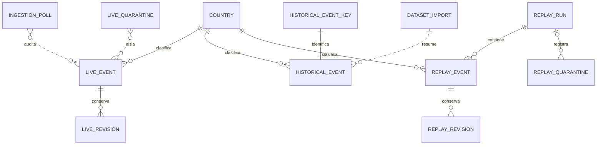
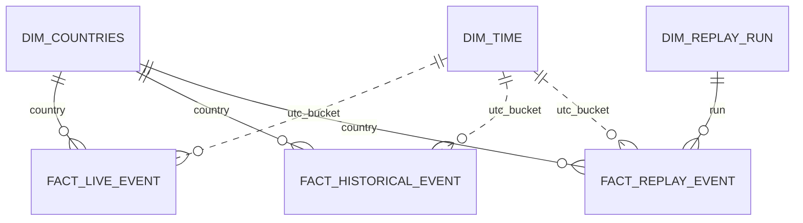
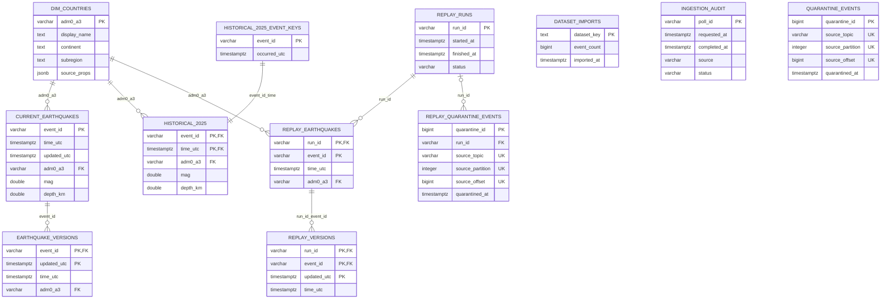

# Modelado de datos y evidencia de índices

Este documento completa el **Criterio 3 (Modelado)** y el **E-05** de la
[rúbrica de evaluación](../001-observatorio-sismico/evaluation-rubric.md).
La definición física vigente es [`init.sql`](../../backend/db/init.sql); los
diagramas y el grano descritos aquí se contrastan con ese DDL.

## Modelo conceptual

Un evento sísmico puede formar parte de tres poblaciones aisladas: el estado
actual (*live*), la instantánea histórica de 2025 y una ejecución de replay.
La dimensión geográfica asigna un país a cada evento, incluido el miembro
explícito «Sin país asignado». El consumidor hace la asignación punto-en-polígono
contra Natural Earth antes de persistir la FK; no se fuerza el país más cercano
cuando no hay intersección. El historial de revisiones, las importaciones y los
registros de auditoría/cuarentena tienen granos propios y no se mezclan con las
poblaciones de eventos.



`DATASET_IMPORT`, `INGESTION_POLL` y las cuarentenas son registros operativos:
sus tablas no tienen FK por evento al conjunto que resumen, auditan o aíslan.
Las relaciones discontinuas expresan esa asociación de negocio y no una
restricción declarada en PostgreSQL.

## Modelo lógico

La persistencia es un modelo relacional normalizado para ingesta transaccional.
Su proyección analítica es una **constelación de hechos** (extensión de un
esquema estrella): las poblaciones live, histórica y replay comparten la
dimensión de país; replay añade la dimensión de ejecución. La dimensión
temporal se deriva en UTC desde `time_utc` y no se almacena como otra tabla.
Estos nombres `FACT_*` y `DIM_TIME` son roles lógicos de consulta, no tablas
físicas ni una propuesta de migración.



`FACT_LIVE_EVENT` representa `current_earthquakes`, `FACT_HISTORICAL_EVENT`
representa `historical_2025` y `FACT_REPLAY_EVENT` representa
`replay_earthquakes`. `DIM_REPLAY_RUN` se obtiene de `replay_runs`; `DIM_TIME`
es una proyección de calendario/intervalo mediante `time_utc`, no una FK real.
El modelo relacional que sigue muestra las tablas y claves efectivamente
declaradas; las particiones físicas no crean entidades lógicas adicionales.



En `HISTORICAL_2025_EVENT_KEYS`, `event_id` es globalmente único y
`(event_id, occurred_utc)` es único. La tabla histórica referencia ese par y
la relación inversa diferida obliga a que la clave tenga una fila histórica.
Las restricciones circulares diferidas permiten insertar ambas filas en una
misma transacción. En tablas particionadas, PostgreSQL exige incluir la clave
de partición en cada clave única; por eso la PK histórica es
`(event_id, time_utc)` y la PK de revisiones es `(event_id, updated_utc)`.
La escritura idempotente live actualiza por `event_id` solo cuando
`EXCLUDED.updated_utc > current_earthquakes.updated_utc` y registra la revisión
aceptada en la misma transacción; el histórico usa la clave global para impedir
duplicados o timestamps incompatibles, y replay conserva la unicidad por
`(run_id, event_id)`. El patrón SQL está documentado al final de `init.sql`.

## Grano de cada relación

| Tabla lógica | Grano: una fila representa | Clave/granularidad |
|---|---|---|
| `dataset_imports` | Una importación identificada de un dataset | `dataset_key` |
| `dim_countries` | Un miembro del catálogo geográfico, incluido `N/A` | `adm0_a3` |
| `current_earthquakes` | El estado vigente de un evento live | `event_id` |
| `earthquake_versions` | Una revisión aceptada de un evento live | `(event_id, updated_utc)` |
| `historical_2025_event_keys` | La identidad global de un evento histórico y su instante | `event_id`; par único con `occurred_utc` |
| `historical_2025` | Una ocurrencia del catálogo histórico de 2025 | `(event_id, time_utc)` |
| `ingestion_audit` | Un sondeo/solicitud a una fuente | `poll_id` |
| `quarantine_events` | Un mensaje live aislado en una posición Kafka | `(source_topic, source_partition, source_offset)` |
| `replay_runs` | Una ejecución aislada de replay | `run_id` |
| `replay_earthquakes` | Un evento dentro de una ejecución replay | `(run_id, event_id)` |
| `replay_versions` | Una revisión de un evento dentro de una ejecución | `(run_id, event_id, updated_utc)` |
| `replay_quarantine_events` | Un mensaje replay aislado en una posición Kafka | `(source_topic, source_partition, source_offset)` |

Las cuarentenas también tienen una PK sustituta `quarantine_id`; la unicidad
del offset Kafka hace idempotente el registro del mensaje. La clave de país
`N/A` evita perder el FK de eventos que no intersectan un polígono; no afirma
que todo evento sin asignación sea necesariamente submarino.

## Modelo físico e índices

El DDL de [`init.sql`](../../backend/db/init.sql) implementa el modelo en
PostgreSQL 16. Las relaciones históricas se particionan por mes de `time_utc`;
`earthquake_versions` se particiona por rango anual de `updated_utc`, con
partición por defecto. Las tablas `replay_*` son separadas y conservan la
unicidad de `(run_id, event_id)`. Las PK, restricciones `UNIQUE` y FK protegen
identidad, idempotencia e integridad referencial; los siguientes índices
adicionales son B-Tree para filtros y ordenaciones de consulta:

| Índice de `init.sql` | Consulta que atiende | Evidencia / matiz |
|---|---|---|
| `idx_current_earthquakes_time` | Ventana `time_utc` más reciente ordenada por tiempo | Plan 1: `Index Scan` real con `LIMIT`. |
| `idx_current_earthquakes_mag` (parcial, `mag IS NOT NULL`) | Umbral/rango de magnitud que omite nulos legítimos | Plan 2: `Bitmap Index Scan` real. El predicado parcial coincide con la semántica. |
| `idx_current_earthquakes_adm0` | Filtro de eventos live por país sin otro filtro | No seleccionado por el optimizador en la población pequeña (694 filas); además, la clave país es prefijo del índice compuesto siguiente. Mantenerlo requiere justificar su coste/beneficio en el volumen de despliegue. |
| `idx_current_earthquakes_country_time` | País más ventana temporal para consultas live | La combinación forma parte de filtros de API. En el snapshot actual el plan ordenado con `LIMIT` prefiere el índice temporal; no se atribuye aquí una mejora medida al compuesto. |
| `idx_historical_2025_time_mag` | Intervalo temporal estrecho más umbral de magnitud | Plan 3: el índice de la partición de julio satisface ambos predicados. |
| `idx_historical_2025_country_time` | País más periodo histórico, con lectura cronológica | Plan 4: `Index Scan Backward` real sobre la partición mensual. |
| `idx_earthquake_versions_event_time` | Leer revisiones por evento de la más reciente a la más antigua | El B-Tree incluye `event_id` y `updated_utc DESC` en cada partición. La PK tiene las mismas columnas en sentido ascendente y también puede recorrerse hacia atrás; es un índice adicional cuya utilidad debe contrastarse con el patrón de lectura y su coste de escritura. |
| `idx_quarantine_events_time` | Revisar o depurar cuarentenas recientes | La tabla de la instantánea solo tiene una fila; no se puede atribuir una mejora observada. |
| `idx_ingestion_audit_completed` | Consultar sondeos recientes por `completed_at` | Plan 5: `Index Scan` real con orden temporal y límite. |
| `idx_replay_runs_started` | Listar ejecuciones replay recientes | Solo hay dos ejecuciones en la instantánea; el plan puede usar escaneo secuencial hasta que crezca la tabla. |
| `idx_replay_earthquakes_run_time` | Ventana temporal de eventos de una ejecución | Índice para `run_id` más tiempo; la consulta de país usa el índice compuesto de mayor selectividad. |
| `idx_replay_earthquakes_run_country_time` | Ejecución, país e intervalo temporal | Plan 6: `Index Scan` real con los tres campos en `Index Cond`. |
| `idx_replay_versions_run_event_time` | Revisiones descendentes de un evento de una ejecución | PK con las mismas columnas ascendentes, recorrible en sentido inverso. La utilidad del índice adicional depende de lecturas de historial medidas. |
| `idx_replay_quarantine_run_time` | Cuarentenas recientes dentro de una ejecución | Índice por ejecución y hora; no hay cuarentenas replay en la instantánea, por lo que su beneficio no se afirma empíricamente. |

Los planes de ejecución son evidencia del acceso elegido para el tamaño y las
estadísticas de esta base, no una garantía de que PostgreSQL vaya a elegir un
índice para cualquier volumen o filtro. El plan diagnóstico 7 muestra
explícitamente que un filtro de país sin selectividad suficiente hace preferir
un escaneo secuencial. Los índices cuya ventaja no se demuestra con esta carga
se identifican como tales, en vez de atribuirles aceleraciones hipotéticas.
Los tiempos dependen de caché, hardware, estadísticas y estado de la base.

## Reproducir la evidencia

Con los servicios Compose levantados y la base del proyecto inicializada,
ejecutar desde la raíz del repositorio en PowerShell:

```powershell
Get-Content -Raw 'specs/004-modelado-y-evidencia-indices/evidence/database-indexes/explain-analyze.sql' |
  docker compose exec -T almacenamiento sh -lc 'psql -X -v ON_ERROR_STOP=1 -U "$POSTGRES_USER" -d "$POSTGRES_DB"'
```

Las consultas son de solo lectura y tienen periodos/run IDs explícitos. El
script usa `EXPLAIN (ANALYZE, BUFFERS)` para ejecutar y medir cada SELECT; no
crea ni modifica tablas o filas. Los tiempos pueden variar. El archivo
[`explain-analyze.txt`](evidence/database-indexes/explain-analyze.txt) conserva
la salida obtenida el 11-11-2026 en PostgreSQL 16.4, con los datos del volumen
local de desarrollo (694 eventos actuales, 18.302 históricos, 2.314 de replay
y 573 sondeos de ingesta). Para comparaciones válidas en otra instalación,
registrar también versión, volumen de filas y estado de caché; no comparar
milisegundos como si fueran una medición controlada.

La inicialización de `init.sql` se ejecuta en volúmenes PostgreSQL nuevos; no
es una migración hacia delante. Una base persistente existente necesita un
cambio de esquema versionado si se modifica el DDL.
